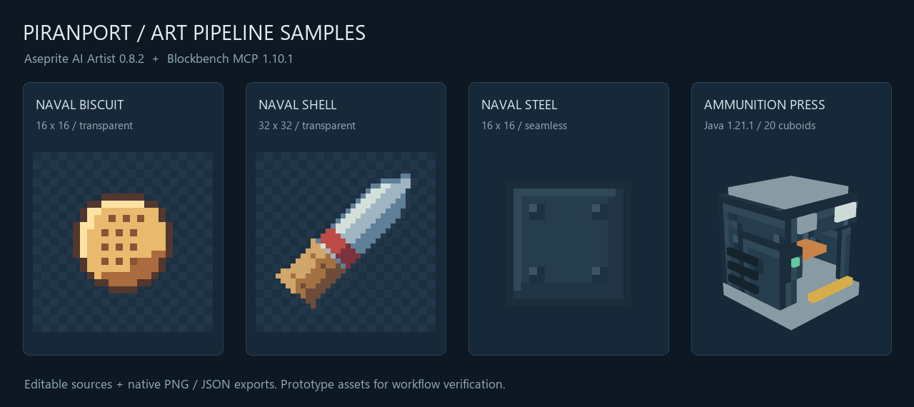

# AI 贴图与建模：本机接入与小样验证

验证日期：2026-10-30。样本仅用于工具流程验证，保留项目原有资源与模组版本 0.1.111。

## 本机接入

| 项目 | 实测状态 |
|---|---|
| Aseprite | `D:/Optical/aseprite/build/bin/aseprite.exe`，`1.3.18.6-8-g3669f4774-dev` 自编译版本 |
| Blockbench | `C:/Program Files/Blockbench/Blockbench.exe`，5.2.2 |
| Node | `C:/Program Files/nodejs/node.exe`，24.19.0 |
| Aseprite AI Artist | 固定0.8.2，本地npm包；Lua扩展装入用户Aseprite目录，live预检成功，发现18个工具 |
| Jason Blockbench MCP | 固定1.10.1，实际加载路径 `F:/codex/tools/mc-art/blockbench-mcp/1.10.1/mcp.js`；Java工程下发现60个工具 |
| Codex配置 | `F:/codex/.codex/config.toml`；`C:/Users/dengl/.codex`为该目录的junction；只新增两个服务器，原配置逐项核对保留 |
| 配置备份 | `F:/codex/.codex/backups/mc-art-mcp-20261030/` |

AI Artist入口固定为 `F:/codex/tools/mc-art/aseprite-ai-artist-0.8.2/node_modules/@pebbly/aseprite-ai-artist/dist/cli.js`，通过绝对Node路径运行`serve`，设置`ASEPRITE_PATH`为上表路径。没有使用会写入`@latest`的默认安装配置，也没有向项目AGENTS追加插件指令。

Blockbench为桌面HTTP模式，端点`http://127.0.0.1:3000/bb-mcp`；日常使用时打开Blockbench。Aseprite为live模式，日常使用时打开Aseprite；桥由MCP服务按需启动。未添加系统开机启动项。

Blockbench的插件文件名必须保持`mcp.js`，版本号放父目录；改名会导致插件ID无法注册。新Java小样将工程版本指定为内部值`1.9.0`，对应编辑器的“1.9–1.21.5”，符合本项目1.21.1；不能使用编辑器默认的最新格式。

## 小样文件

| 小样 | 文件 | 规格 |
|---|---|---|
| 海军饼干 | [PNG](textures/item/naval_biscuit_16.png)、[Aseprite源文件](sources/naval_biscuit_16.aseprite) | 16×16，5个可见颜色，1像素透明边距 |
| 舰炮弹 | [PNG](textures/item/naval_shell_32.png)、[Aseprite源文件](sources/naval_shell_32.aseprite) | 32×32，9个可见颜色，2像素透明边距 |
| 海军蓝钢板 | [PNG](textures/block/naval_steel_16.png)、[Aseprite源文件](sources/naval_steel_16.aseprite) | 16×16，6色，不透明；左右和上下边缘差异均0 |
| 弹药压机 | [Java模型](models/block/ammunition_press.json)、[Blockbench源文件](sources/ammunition_press.bbmodel) | 20个轴对齐方块，全部位于0–16；7张16×16材质，含钢板小样 |

[正面斜视](previews/ammunition_press-front.png)、[背面斜视](previews/ammunition_press-rear.png)、[正视](previews/ammunition_press-straight.png)、[钢板3×3平铺](previews/naval_steel_16_3x3.png)。模型源文件内嵌全部材质，也已在Blockbench原生保存。

## 验证范围

- 贴图通过真实Aseprite MCP绘制、回看、保存与导出；PNG只包含0/255透明度。炮弹和钢板的工具校验无warning/error；选择性轮廓与工业板直缝提示保留。工具分数不作为审美评价。
- Aseprite以MCP改动测试像素，再用原生Ctrl+Z／Ctrl+Y撤销重做；逐像素确认撤销回到基线、重做恢复改动，最终恢复基线。
- Blockbench以MCP修改压头尺寸，调用原生undo／redo；比较完整Java导出内容，最终恢复基线。
- 检查模型边界、正体积、UV范围、材质引用及实际PNG文件；检查Java版本字段和内嵌材质。
- 独立客户端目录`run/art-mcp-smoke-20261030`、独立构建输出`build/art-mcp-smoke-20261030`；JDK21、MC1.21.1、NeoForge21.1.259。测试包位于模组资源之后，主菜单资源检查通过，104物品提示检查完成；未加载任何世界。
- 本轮完成编辑器三视图和客户端资源加载验证；世界内摆放、碰撞与实际物品图标截图未验证，小样尚未整合为正式美术。

完整结果：[summary.json](evidence/summary.json)、[客户端检查](evidence/client-smoke-summary.json)、[客户端日志](evidence/client-smoke.log)、[Aseprite撤销比对](evidence/aseprite-undo-verification.json)、[Blockbench撤销比对](evidence/blockbench-undo-verification.json)。中间绘制记录保留在`evidence/`。

## 独立测试资源包

[PiranPort-Art-Samples.zip](PiranPort-Art-Samples.zip)采用资源包格式34。仅在测试包启用期间，将`scone`贴图映射为饼干小样，`high_explosive_shell`贴图映射为炮弹小样，`ammunition_factory`方块模型映射为压机小样；不新增注册项，不改变合成、功能、交互或碰撞形状。该包用于加载验证，上述映射不代表正式美术决定。

## 接入来源

- [AI Artist 0.8.2](https://github.com/with-pebbly/aseprite-ai-artist/tree/v0.8.2)
- [Blockbench MCP 1.10.1](https://github.com/jasonjgardner/blockbench-mcp-plugin/releases/tag/v1.10.1)
- [Codex MCP配置](https://learn.chatgpt.com/docs/extend/mcp?surface=cli)
