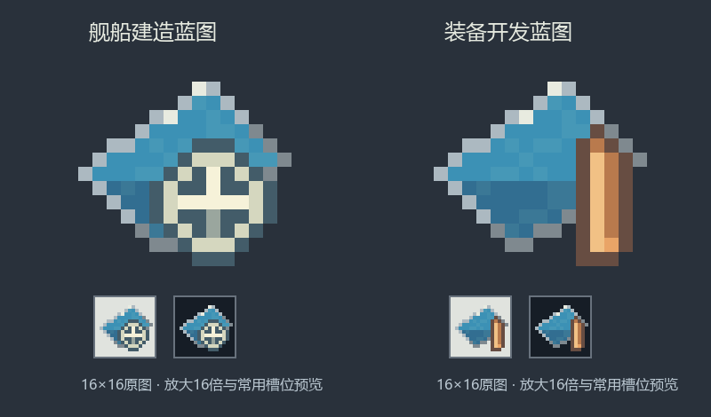

# 蓝图16×16第三版归档

> 本页版本为合并前的历史标签，对照见[版本合并说明](../../../../美术连续修订版本合并说明.md)。

版本0.1.137，舵轮使用全周深色描边。当前版本见[蓝图贴图记录](../../README.md)。

[舰船图源文件](sources/ship_blueprint.aseprite)、[像素规格](design-spec.json)、[当时的检查记录](validation.json)。
