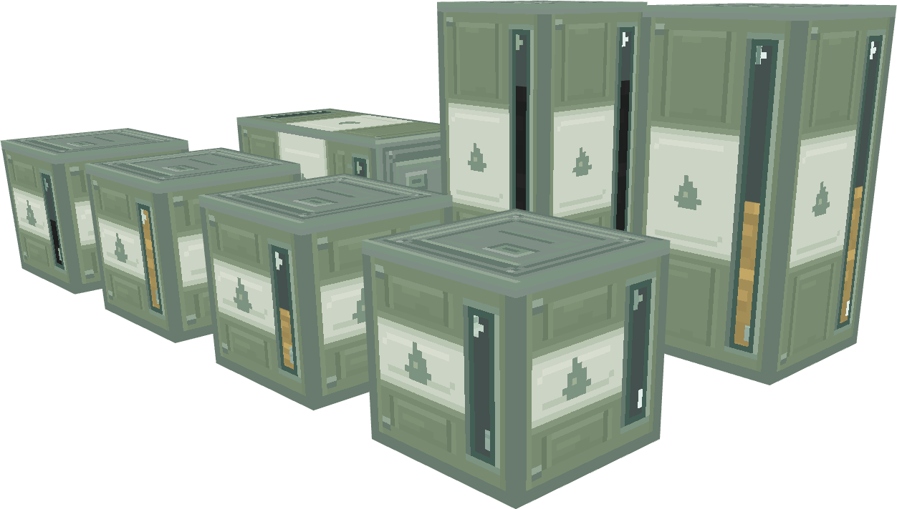
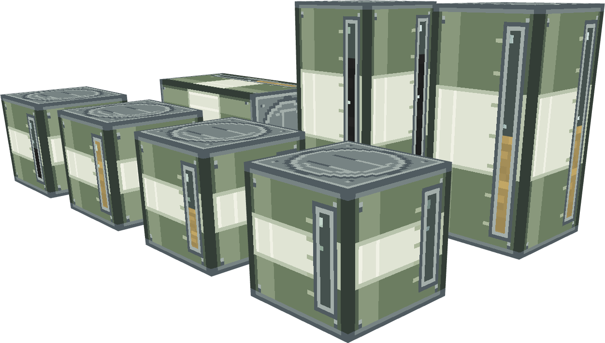
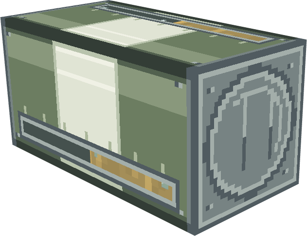

# 燃料桶方块：外观草稿

第三版已于0.1.132接入游戏，包含正式贴图、三轴配对模型及动态液位，见[接入记录和游戏实景](../fuel-barrel-20261031-runtime/README.md)。本目录保留设计过程与固定液位样机。

当前第三版参考格雷科技现代版储罐，采用规整的直线压筋、浅嵌板与小倒角矩形端盖，保留柔和灰绿／灰白三段及连续视窗。说明及源文件见[第三版记录](revisions/gregtech-v3/README.md)，[第二版记录](revisions/modern-v2/README.md)保留供对照。

横放方向已修正：火焰标记朝上，双桶共用竖向视窗，液位从底部向上填充。

[当前水平双桶预览](revisions/gregtech-v3/previews/pair_horizontal_fuel_half-upright.png) · [当前Blockbench总模型](revisions/gregtech-v3/models/fuel_barrel_design_board.bbmodel)

## 首版归档

2026-10-31。以舰R拆包燃料图标中的油桶为参考，按直立方向重排结构，制作完整立方体桶身。草稿保存在独立目录，生产版本仍为0.1.130。

前排依次展示空桶、燃油半满、燃油满桶和原油半满；后排为双桶组合。灰绿、暖白、灰绿三段覆盖四个侧面，铁灰色端盖使用阶梯圆环及压筋图案，桶体没有缩边或圆柱化。

水平双桶共用一条沿长轴的视窗和一组灰绿／白／灰绿分段。端盖只出现在组合两端，连接处不增加中间端盖或视窗横框。

## 首版规格

| 项目 | 单桶 | 双桶 |
|---|---|---|
| 外形 | 16×16×16完整方块 | 16×32×16完整长方体，可沿轴旋转 |
| 侧面纹理 | 32×32 | 32×64连续纹理 |
| 主色 | 灰绿`#6C7D61`、暖白`#E0E4D4` | 共用整套三段，不重复两套条纹 |
| 桶底／桶盖 | 铁灰`#778383`及同色明暗 | 仅保留组合外端 |
| 视窗 | 四个侧面各一条细长窗 | 每个侧面合为一条长窗，中心没有断框 |
| 油料颜色 | 使用现有原油／燃油静水动画的首帧 | 共用同一油料与总量比例 |

当前为可编辑视觉样机，窗内油料分别用独立几何层表示，展示空、50%、75%和满量效果。预览不是已接入方块实体的实时液位。

竖放时按高度显示液位；横放首版按沿长轴填充的总量指示条表达容量，50%为连续窗的一半。它是总量刻度设计，不表示油在重力作用下向一端倾斜。

## 文件

- [总预览板](models/fuel_barrel_design_board.bbmodel)：7种示例，含单桶、竖直双桶与水平双桶。
- [水平双桶模型](models/pair_horizontal_fuel_half.bbmodel)：独立近景示例。
- [models](models/)：其余6个独立模型，可在Blockbench直接打开。
- [sources](sources/)：6份Aseprite可编辑贴图源文件。
- [textures](textures/)：桶身、组合桶身、铁灰端盖、内部衬板和两种油料材质。
- [舰R原始参考](references/wgr_common_source_1.png)：来自既有拆包归档，原始文件保持不变。
- [design-spec.json](design-spec.json)、[verification.json](verification.json)：设计参数与机械检查结果。
- [build_models.py](build_models.py)：根据贴图重建模型草稿，不写入生产资源目录。

像素贴图在已打开的Aseprite中绘制、保存与导出；模型在本机Blockbench中实际打开检查，预览PNG由其“截屏模型”导出。

## 后续接入约束

本轮只交付首版模型与贴图预览。游戏内自动选择单桶／双桶纹理、总油量同步及动态视窗尚未接入，原有方块与配对行为保持原样。

接入时复用现有有效伙伴与轴向，不引入新的配对规则。视窗按两格实际油量之和／当前总容量显示，不能把master优先填充误画成两个互不相关的液位。过量存量的显示可封顶，但储量和配置降容守恒不得改变；切轴、断开及伙伴暂不可用时遵循既有规则。

双桶渲染可将连续侧纹理在两格交界处分为两半，内部端盖不绘制。图案的“起／终”按轴向空间位置决定，不沿用水平桶的先放置master身份；容量仍由现有流体能力提供，不增加新的油量存档字段。
