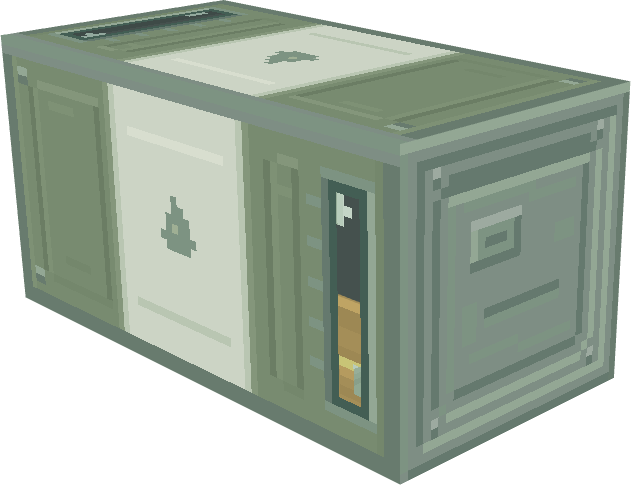

# 燃料桶外观第三版：直线压筋与矩形端盖

2026-10-31。在第二版柔和灰绿／灰白配色上，参考格雷科技现代版油桶与储罐的直线结构，重新整理桶身面板。此目录保留设计样机；正式贴图和动态液位已于0.1.132接入游戏，见[游戏实景与接入记录](../../../fuel-barrel-20261031-runtime/README.md)。

横放方向已修正：火焰标记在两个竖直侧面都朝上，不再随桶轴旋转90°；共用视窗改为竖向，油体按世界Y轴从底部向上填充，50%时窗内下半段显示燃油。三段色带仍沿双桶长轴共用，端盖保留矩形图案。顶部和底部窗口为俯视／仰视开口，不将其当作竖向刻度读数。

## 图案调整

| 部位 | 第三版处理 |
|---|---|
| 上下灰绿段 | 用成对直线压筋和规整的内凹面板替换零散短刻线，减少装饰的随意感 |
| 中央白带 | 整理为浅嵌板，保留油滴标记和少量漆面色簇；没有增加第三套金属腰箍 |
| 端盖 | 同心圆环改为两像素切角的矩形压板，长直边为主，消除连续圆弧阶梯 |
| 加注口 | 使用偏置矩形小盖及短横槽，四角仅保留低对比紧固点 |
| 视窗 | 保留细嵌框及端部玻璃反光；竖放双桶保留连续长窗，横放双桶共用一个竖向液位窗 |
| 配色与结构 | 延续灰绿`#788B70`、灰白`#CCD4C5`、铁灰`#7E8E84`；完整方块与两格共用三段色带保持一致 |

## 参考来源

- [格雷科技现代版油桶侧面](https://github.com/GregTechCEu/GregTech-Modern/blob/ec40d99d6a6e24d130bf4ddae0d7243281afad45/src/main/resources/assets/gtceu/textures/block/storage/drums/drum/side.png)：参考竖向压筋与水平金属边带的组织。
- [油桶端盖](https://github.com/GregTechCEu/GregTech-Modern/blob/ec40d99d6a6e24d130bf4ddae0d7243281afad45/src/main/resources/assets/gtceu/textures/block/storage/drums/drum/top.png)：参考内凹方形轮廓及偏置加注部件。
- [量子储罐面板](https://github.com/GregTechCEu/GregTech-Modern/blob/ec40d99d6a6e24d130bf4ddae0d7243281afad45/src/main/resources/assets/gtceu/textures/block/overlay/machine/overlay_qtank.png)：参考简洁的矩形嵌框。

本次查看的是官方仓库`1.20.1`分支、提交`ec40d99d6a6e24d130bf4ddae0d7243281afad45`。本桶像素在Aseprite中重新绘制，参考素材没有直接贴到模型上。原图、模型定义和许可副本已归入外部资料库，本地路径见[参考文件索引](references/README.md)，固定来源链接见[sources.json](references/sources.json)。上一版Create、Mekanism和原版材质参考见[第二版记录](../modern-v2/README.md)。

## 文件与验证

- [Blockbench总览模型](models/fuel_barrel_design_board.bbmodel)与[水平双桶模型](models/pair_horizontal_fuel_half.bbmodel)，以及其余6个独立示例。
- [sources](sources/)：8份可编辑Aseprite文件；[textures](textures/)：8张PNG，含64×32横放双桶及生产接入时补充的32×32横放单桶侧纹理。
- [texture-layout.json](texture-layout.json)：3张重绘贴图的像素网格与既有调色板；[upright-layout.json](upright-layout.json)：横放侧面朝上图标与竖向窗口；[build_models.py](build_models.py)：重建草稿模型。
- [verification.json](verification.json)：PNG尺寸／透明度／哈希、像素与绘制网格一致性、8个模型的几何与UV、嵌入贴图及连续视窗检查。

两张设计预览由本机Blockbench实际打开模型后使用“截屏模型”导出。单桶边界16×16×16，竖直双桶16×32×16，水平双桶32×16×16；竖放示例的几何和UV保持一致，横放示例改用独立侧面UV与沿Y轴升高的油体。窗内衬板及两种油料贴图沿用第二版。[verification.json](verification.json)为草稿阶段检查，生产接入后的验证见接入记录。

本目录Blockbench样机使用固定液位示例，游戏中已实现动态视窗与配对换模。横放和竖放液位均从下向上，不能将油体及标记一起旋转到桶轴方向。其余接入约束继续沿用[首版记录](../../README.md#后续接入约束)。[方向修正前近景](previews/pair_horizontal_fuel_half.png)保留供对照。
