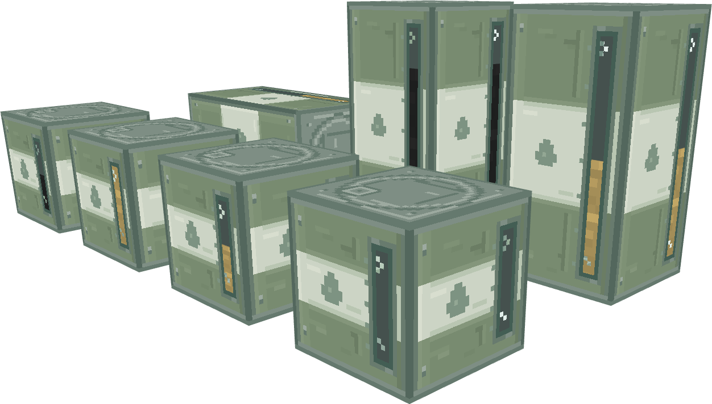
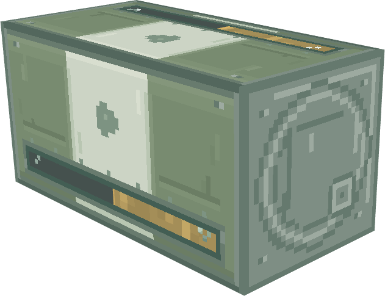

# 燃料桶外观第二版：柔化配色与材质细节

2026-10-31。保留首版完整方块、灰绿／白／灰绿三段、轴向双桶共用侧纹与连续视窗，调整像素组织及配色。仍为外观草稿，未替换生产资源，工程版本保持0.1.130。

## 改动

| 部位 | 第二版处理 |
|---|---|
| 桶身 | 灰绿改为`#788B70`，白带改为偏灰的`#CCD4C5`，减少大色块之间的亮度跳变 |
| 色带交界 | 使用邻近色的1–2像素过渡，搭配少量不规则色簇，保持硬像素边缘 |
| 轮廓 | 收窄外边框明暗差，移除首版显眼的深色描边与整条亮色竖带 |
| 材质 | 增加低对比漆面色簇、短浅压筋及小铆钉，不铺满随机噪点 |
| 白带 | 添加低对比油滴标记，保留三段配色的主体辨识度 |
| 视窗 | 改为较暗的薄嵌框和冷绿玻璃反光，油料颜色保持不变 |
| 端盖 | 铁灰改为`#7E8E84`，用浅压筋、偏置注油塞及局部高光替换首版等号状装饰 |

按加权sRGB通道值计算，灰绿与白带主色的差值从约106.6缩小到76.2，降低约28.5%。该指标用于记录配色变化，不代替视觉确认。

## 参考与取舍

- [Create 1.21.1 储罐侧纹理](https://github.com/Creators-of-Create/Create/blob/4148fd8d5b05c85d88947edc00fb495a5074f57d/src/main/resources/assets/create/textures/block/fluid_tank.png)：参考同色系金属层次、浅压筋及局部磨损的位置组织。
- [Create 储罐顶面](https://github.com/Creators-of-Create/Create/blob/4148fd8d5b05c85d88947edc00fb495a5074f57d/src/main/resources/assets/create/textures/block/fluid_tank_top.png)：参考端盖凹槽及表面色块。
- [Mekanism 1.21.x 储罐纹理](https://github.com/mekanism/Mekanism/blob/bcd7a8bf594cff9614eb12238fe3776f19da24d9/src/main/resources/assets/mekanism/textures/block/models/fluid_tank.png)：参考较细的框体及玻璃与金属的分界。
- 本机Minecraft1.21.1原版木桶、炼药锅、铁块：观察接缝、小色簇及低对比材质层次。

以上为风格参考，第二版桶身与端盖的像素重新绘制，没有将第三方储罐纹理贴到本模型上。参考图和许可副本已归入外部资料库，本地路径见[参考文件索引](references/README.md)，官方路径与固定提交见[sources.json](references/sources.json)。

## 文件与检查

- [总预览模型](models/fuel_barrel_design_board.bbmodel)和[水平双桶模型](models/pair_horizontal_fuel_half.bbmodel)。
- [sources](sources/)包含可编辑Aseprite源文件；[textures](textures/)为本版贴图。
- [verification.json](verification.json)记录8个模型的几何／UV检查、透明度、共享视窗连续性和PNG哈希。
- [首版整体图](../../previews/design-board.png)与[首版水平双桶](../../previews/pair_horizontal_fuel_half.png)保留供对照。

模型边界、几何、UV、视窗开口、容量示例以及窗内原油／燃油材质与首版一致。单桶为16×16×16，双桶为16×32×16；双桶交界的窗内区域仍连续。所有生产文件保持原哈希，没有改变油料、配对或存储行为。

本版已在Blockbench实际打开查看并导出两张预览。视觉样机仍使用固定液位示例；游戏内动态液位和合并换模未接入。
