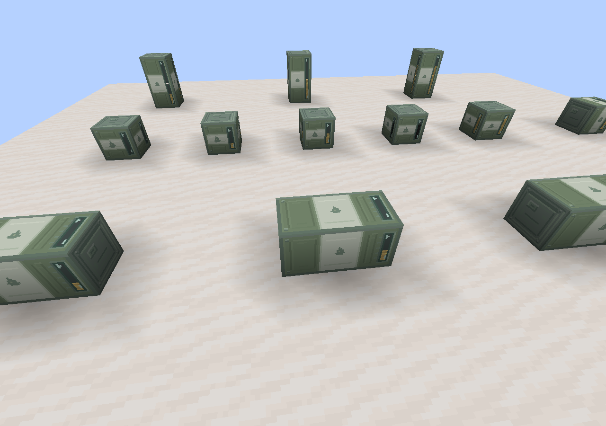

# 燃料桶正式贴图与动态液位

> 当前燃料桶阶段对应0.1.120–0.1.123。下文及修订目录中的原0.1.131–0.1.134保持为历史证据标签，见[旧新对照](../../美术连续修订版本合并说明.md)。

2026-10-31，燃料桶验证原基线0.1.134；外观与动态液位在原0.1.132接入。第三版灰绿／灰白完整方块支持三轴单桶、轴向双桶共用花纹与动态液位。连接漏缝已修复，流体纹理已改为固定比例裁剪，见[接缝修复](revisions/seam-0.1.133/README.md)和[纹理裁剪记录](revisions/uv-crop-0.1.134/README.md)。

[全部示例](screenshots/fuel-barrel-overview.png) · [单桶近景](screenshots/fuel-barrel-singles.png)

## 外观与显示规则

| 场景 | 显示 |
|---|---|
| 单桶 | 完整16×16×16方块；三轴端盖位置正确；侧面火焰朝上 |
| 竖直双桶 | 两格共用灰绿／灰白／灰绿三段，长视窗跨两格连续 |
| 水平双桶 | 两格共用长轴三段，竖直侧面火焰朝上，使用一个共用竖向视窗 |
| 动态液位 | 总流体量／配置容量，油面始终沿世界Y轴升高；超额仅封顶显示 |
| 合并与拆分 | 外观按轴向空间坐标划分两端，内部不画端盖，不依赖先放置的master身份 |
| 伙伴暂不可用 | 不加载伙伴区块或删除存量；暂按本格显示，伙伴恢复后重新汇总 |
| 桶物品 | 图标采用正式单桶模型及空窗；携带内容仍通过原流体组件保存 |

服务端的显示快照仅包含共用流体及配置容量，不增加持久化油量字段。实际流量及配对变化立即通知两格，20 tick低频复核配置和区块可用性，快照未变化时不发送更新。客户端不通过服务端专用流体能力查询，也不修改库存或伙伴关系。

视窗读取流体的真实静止动画图集及tint，原油和燃油继续沿用现有水纹动画及各自颜色；通用FluidTank的流体准入规则保持一致。视窗范围为16像素模型单位中的3–13；竖直双桶的共同范围为3–29，按该范围映射百分比。

流体UV按方块局部坐标固定为每格一个纹理周期，随液位裁剪采样范围，不能把整帧纹理缩放到当前液体高度；顶底面也使用固定比例。

## 源文件和代码

- [第三版美术源文件](../fuel-barrel-20261031-draft/revisions/gregtech-v3/README.md)，生产接入时补充32×32横放单桶贴图，其余定稿像素保持一致。侧纹为32×32、32×64及64×32，端盖32×32、内衬16×16。
- [模型生成器](../../../tools/generate_fuel_barrel_models.py)：复制6张正式材质并生成9种`axis`／`part`模型，输出到`src/main/resources/assets/piranport/`。
- [FuelBarrelBlockEntity](../../../src/main/java/com/lex0v0/piranport/blockentity/FuelBarrelBlockEntity.java)：空间分段及客户端显示快照；存档仍由原有本格流体负责。
- [FuelBarrelRenderer](../../../src/main/java/com/lex0v0/piranport/client/renderer/FuelBarrelRenderer.java)：在视窗之后绘制液体，使用世界高度计算三轴液位。
- 渲染与同步接口参考NeoForge 1.21.1官方[BlockEntityRenderer](https://docs.neoforged.net/docs/1.21.1/blockentities/ber/)及[方块实体数据同步](https://docs.neoforged.net/docs/1.21.1/blockentities/)文档。

## 验证（0.1.132接入基线）

JDK21.0.5／Minecraft1.21.1／NeoForge21.1.259，2026-10-31。

- 324个JSON资源检查通过，覆盖九种模型、完整方块边界、UV范围、内端盖移除及竖直侧面标记方向。
- 新增4项显示回归，231项required GameTest的实际发现／完成／通过数均为231。
- 全新隔离世界验证25个桶成员的客户端快照、抽油后双桶同步、三轴液位向上，生成4张游戏实际截图。
- 发行包排除了GameTest及开发美术资源。完整报告见[validation.json](validation.json)，本机原始证据在`build/fuel-barrel-runtime-20261031/`。

覆盖映射共210项，其中141完整、69部分；J38保留部分覆盖。真实多人、完整区块卸载重启及第三方渲染器／光影仍需人工复核。
