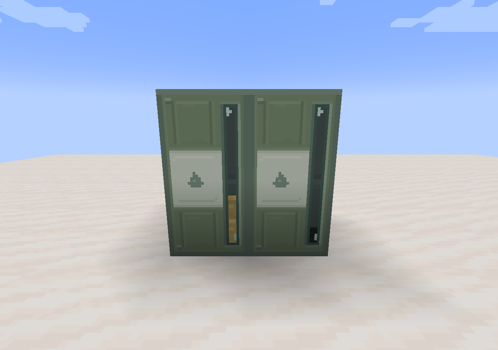

# 燃料桶轴向连接处视窗漏缝修复

2026-10-31，0.1.133。修复轴向双桶视窗在连接处出现几像素亮条或油色杂块的问题。

[修复前对照](before/fuel-barrel-seam-front.png) · [修复前空桶漏光](before/fuel-barrel-seam-empty.png) · [修复后空桶](after/fuel-barrel-seam-empty.png) · [修复后满桶](after/fuel-barrel-seam-full.png)

## 原因与修正

侧面贴图的透明开口在两格交界处本来就是连续的。模型生成器却继续将每格内衬的两端都内缩0.3模型单位，连接处合计留下0.6模型单位的空隙。从视窗斜看时，这条空隙会露出地面或桶内后方油面，因此在实际液位上方出现白条、黄条或杂块。

连接起端的内衬延伸到该轴的16，终端的内衬从0开始，两侧在共同边界闭合。三个轴向的6份连接模型均已修正；单桶仍保留原来的内缩，连接内部也没有增加端盖。

生产JAR对照确认，仅6份模型JSON与模组版本元数据改变，所有生产Java类和PNG逐字节保持一致。液位、流体储量、配对、贴图像素及动画规则没有调整。

## 验证范围

- 构建及324个JSON检查通过；资源脚本新增共用端内衬必须抵达边界的检查。
- 新建隔离客户端世界，核对三轴6个连接模型共24个真实烘焙内衬侧面的几何边界。
- 复核正面、左右斜视、俯视、空桶及满桶6组实际截图。
- 同一空桶正面画面的两个接缝采样区，修复前分别有120／120、104／104个亮像素，修复后均为0。

报告见[validation.json](validation.json)，原始日志与两次独立世界位于`build/fuel-barrel-seam-20261031/`。231项GameTest已编译，本轮没有重复执行服务端回归；0.1.132的服务端基线保留在[接入记录](../../README.md)。
