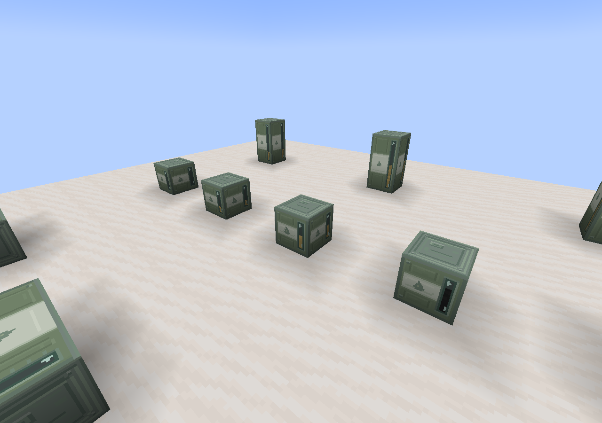

# 燃料桶液体纹理固定比例裁剪

2026-10-31，0.1.134。修正视窗低液位时将整帧流体纹理压缩到当前高度、导致花纹变扁的问题。

[竖直双桶](screenshots/fuel-barrel-vertical.png) · [水平双桶](screenshots/fuel-barrel-horizontal.png) · [全部场景](screenshots/fuel-barrel-overview.png)

## 映射规则

原实现为每个液体面固定使用完整的U／V范围，液位降低时，V轴整个纹理帧仍被塞入变短的表面。新实现以方块坐标为纹理锚点，每格对应一个纹理周期，按面朝向投影顶点坐标得到U／V。侧面V为`1−局部Y`，液面下降仅裁去上方采样范围，底部花纹的位置和纹理比例保持固定。

顶面与底面按X／Z位置取样，使用同样的固定比例；各格坐标在整数边界衔接为周期纹理。仍使用实际动画图集和流体tint，没有裁写PNG或生成独立静态帧。

液位几何、储存及同步规则、模型、贴图像素、动画元数据均保持原样。发行包对照只有`FuelBarrelRenderer.class`和模组版本元数据改变。

## 验证

- JDK21.0.5／Minecraft1.21.1／NeoForge21.1.259，构建与324个JSON检查通过。
- 在新建隔离世界中捕获渲染器实际提交的顶点，验证三轴、单桶／连接两端和七档液位，共59组非空液体网格；每个面的两个正交边均保持纹理跨度与几何长度一致，底部UV锚点稳定。
- 25个桶成员同步、抽油更新、24个连接内衬烘焙侧面及4张游戏截图检查通过。
- 231项GameTest已编译，本轮没有重复执行服务端回归；本轮范围为客户端UV修正。

完整报告见[validation.json](validation.json)，原始证据在`build/fuel-barrel-uv-20261031/`。已有真实多人及第三方渲染器／光影的人工范围继续保留。
