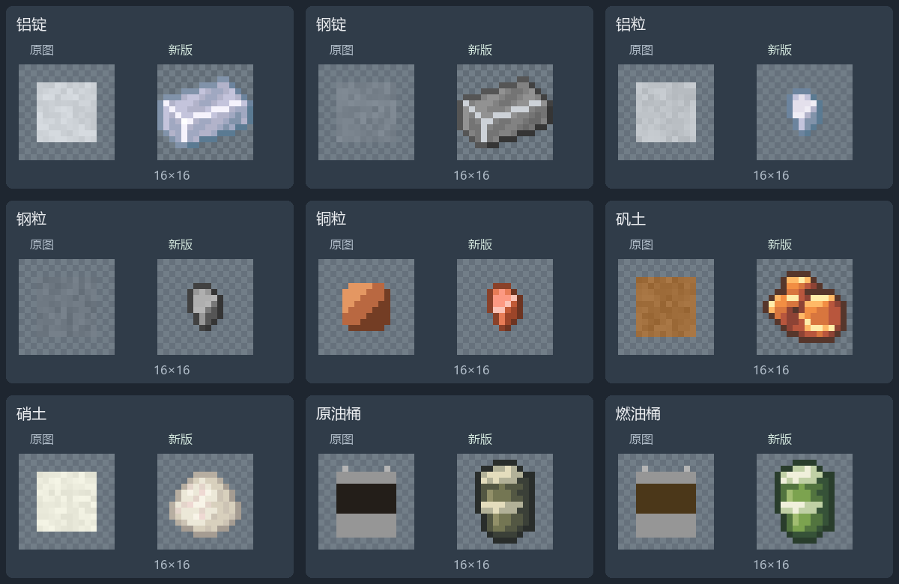
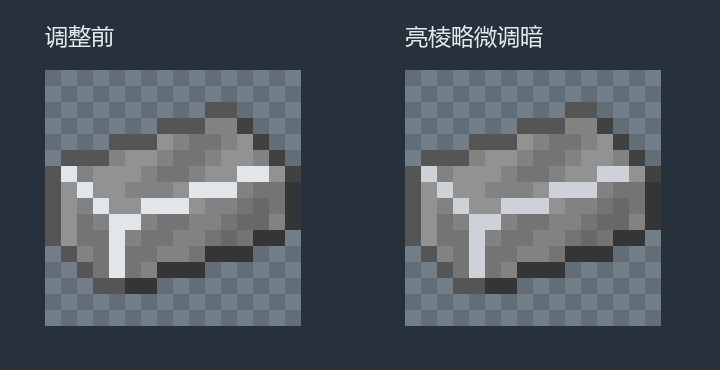
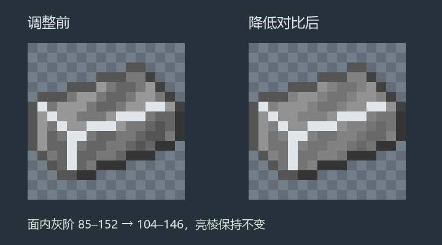
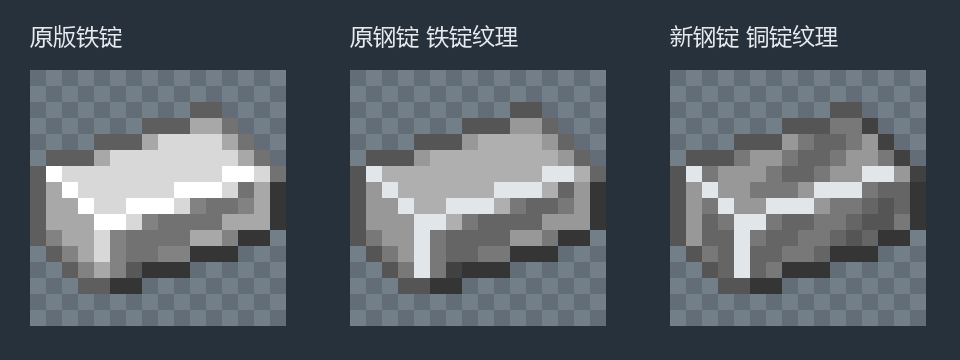
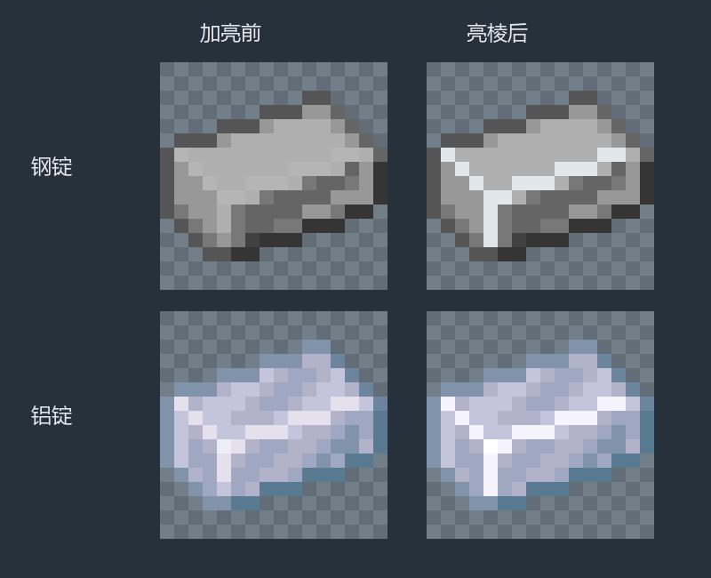
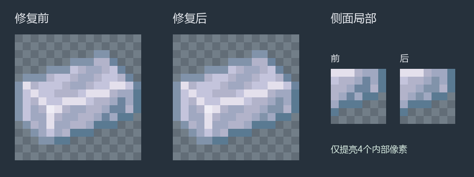
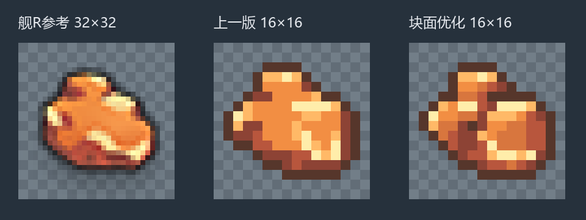

# 材料与油桶物品贴图

> 当前计数：首版及原0.1.113–0.1.117连续修订统一归入0.1.112。下文版本标签为生成时的原号，见[旧新对照](../../美术连续修订版本合并说明.md)。

2026-10-30，0.1.112–0.1.117：9张16×16 RGBA贴图已替换生产资源，保留透明背景与硬像素边缘。视觉效果待确认。

两种桶图已在0.1.129改为原版水桶样式，仅桶口液体改色；当前源文件、配色与预览见[油品外观记录](../oil-appearance-20261031/README.md)。下方油桶首版对比及原源文件作为历史保留。

## 钢锭亮棱微调

钢锭16个亮棱像素由`#e1e6eb`略微调暗为冷灰`#cdd2d8`。铜锭纹理布局、104–146的面内灰阶、外轮廓与透明区域保持不变。修改前后PNG、源文件、[像素规格](revisions/steel_ridge_tone/pixel-spec.json)及[一致性检查](revisions/steel_ridge_tone/verification.json)保存在[亮棱微调目录](revisions/steel_ridge_tone/)。

## 钢锭三面明暗调整

钢锭面内灰阶范围由85–152收窄至104–146，跨度减少约37%；三个主要灰阶由101／120／152调整为116／130／146，四个侧面暗点提亮为104。轮廓、透明区域、铜锭纹理布局与16个三面亮棱像素保持不变，该轮保留浅冷灰亮棱`#e1e6eb`，现用亮棱颜色见上方微调。

修改前后PNG、可编辑源文件、[像素规格](revisions/steel_contrast/pixel-spec.json)及[明暗与一致性检查](revisions/steel_contrast/verification.json)保存在[灰阶修订目录](revisions/steel_contrast/)。

## 钢锭铜锭纹理

下图为0.1.115阶段的铜锭纹理调整，钢锭当前较柔和的灰阶见上图。

钢锭改用原版1.21.1铜锭的表面纹理图案，避免与原版铁锭的平整亮面混淆。保留钢的深灰色阶、16个三面亮棱像素和原透明轮廓，四个侧面暗点采用与铝锭相同的区分处理。当前铝锭与钢锭均以铜锭为纹理参考，通过冷银蓝与深灰配色区分。

修改前后PNG、源文件、[像素规格](revisions/steel_copper_pattern/pixel-spec.json)和[一致性记录](revisions/steel_copper_pattern/verification.json)保存在[钢锭纹理修订目录](revisions/steel_copper_pattern/)。

## 钢锭与铝锭三面亮棱

下图为0.1.114阶段的亮棱修订；钢锭现用的铜锭纹理见上图。

钢锭使用浅冷灰亮棱，铝锭使用银白亮棱和白色交点高光。顶面、前面与左侧面的三条交界组成连续Y形线，补齐交点下方的竖棱，每张调整16个像素。外轮廓、透明区域和面内纹理不变，铝锭已提亮的4个侧面暗点继续保留。

加亮前后PNG与可编辑源文件、[像素差异](revisions/ingot_edges/pixel-diff.json)及[逐像素规格](revisions/ingot_edges/after-specs.json)保存在[亮棱修订目录](revisions/ingot_edges/)。

## 铝锭侧面明暗修复

铝锭侧面4个内部暗点与外轮廓颜色过近，已将`(13,8)`、`(12,9)`、`(13,9)`、`(11,10)`的颜色由`#6c849e`提亮为现有色板的`#8193aa`。坐标从左上角零起算，形状、透明区域、外轮廓和顶面高光不变。原图、源文件和[像素差异记录](revisions/aluminum_ingot/pixel-diff.json)保存在[修订目录](revisions/aluminum_ingot/)。

## 矾土重绘

现用第三版保持16×16，使用7种可见颜色。三块矿料通过斜向块面交界、深色遮挡缝和更硬的轮廓转折分出前后；亮顶面、中间橙色正面和赭红侧面形成体积。顶部、左侧与右上高光保留舰R参考位置，右下高光改为沿折角斜面分段，避免大面积平涂与圆弧包边。

历版PNG、可编辑源文件及像素规格保存在[修订目录](revisions/bauxite/)，第二版的[轮廓修订对比](revisions/bauxite/comparison.png)保留归档。当前生产图和`sources/bauxite.aseprite`已同步第三版。

## 造型与配色

| 资源 | 造型及纹理依据 | 配色 |
|---|---|---|
| `aluminum_ingot` | 保留原版1.21.1铜锭轮廓，侧面4个暗点提亮并加强三面银白亮棱 | 热力基本铱的冷银蓝、淡紫白色阶 |
| `steel_ingot` | 原版1.21.1铜锭表面纹理，保留三面浅冷灰亮棱与侧面区分处理 | 参考热力基本钢的深灰色阶，面内灰阶收窄至104–146 |
| `aluminum_nugget` | 原版1.21.1金粒，逐像素保留结构 | 与铝锭共用铱参考色阶 |
| `steel_nugget` | 原版1.21.1金粒，逐像素保留结构 | 与钢锭共用钢参考色阶 |
| `copper_nugget` | 原版1.21.1金粒，逐像素保留结构 | 直接采用原版铜锭的铜色，不含氧化绿 |
| `bauxite` | 保留舰R铝材的非对称三块矿料，用硬折角及遮挡缝分出前后 | 亮顶面、中间橙色正面、赭红侧面，保留主要高光位置 |
| `saltpeter` | 原版黏土球结构，结合沙子颗粒色块 | 保留原占位图的浅米白基调，加入少量浅粉色 |
| `crude_oil_bucket` | 现用原版水桶，金属与轮廓不变 | 桶口原油主色`#1B1B1B` |
| `fuel_oil_bucket` | 现用原版水桶，金属与轮廓不变 | 桶口采用柴油色`#C19E57` |

铝锭与钢锭均使用原版铜锭纹理。五张锭／粒图均保留原版轮廓和透明区域；三张粒图仍保持原版同色像素分布，仅替换色阶。两种锭均保留16个三面交界亮棱像素，并将铜锭纹理中的4个侧面暗点与外轮廓区分。矾土与油桶依据原图提炼轮廓后手工编排像素，没有直接将高清原图缩小充当成品。

## 参考来源

- 原版纹理从本机Minecraft1.21.1客户端资源中提取：`iron_ingot`、`copper_ingot`、`gold_nugget`、`clay_ball`、`sand`及`clay`，参考副本已归入外部资料库，本地路径见[参考文件索引](references/README.md)。
- 热力基本采用[MC百科对应模组](https://www.mcmod.cn/class/425.html)及Team CoFH官方的[铱锭](https://teamcofh.com/docs/1.12/thermal-foundation/iridium-ingot/)、[钢锭](https://teamcofh.com/docs/1.12/thermal-foundation/steel-ingot/)图标作为配色依据。官方图标参考副本分别为`E:/Leisure/Coding/Minecraft/mc-refs/ThermalFoundation/reference-snapshots/teamcofh-1.12/web-icons/thermal_iridium.webp`与`E:/Leisure/Coding/Minecraft/mc-refs/ThermalFoundation/reference-snapshots/teamcofh-1.12/web-icons/thermal_steel.webp`。
- 舰R素材来自本机`D:\Games\Warship Girls R\APK\v5.5.1\拆包合并，包含高清\assets\data\ui\common.unity3d`；`common_source_4`为铝材，`common_source_1`为燃料。参考副本为`references/wgr_common_source_4.png`与`references/wgr_common_source_1.png`。

## 源文件与验证

使用Aseprite AI Artist0.8.2的live模式编辑、检查并导出。可编辑源文件保存在[sources](sources/)，替换前9张图保存在[previous](previous/)，逐像素规格保存在[pixel-specs.json](pixel-specs.json)。

- [首版Aseprite检查记录](aseprite-validation.json)：9张均无错误或警告；第三版矾土另经[单项复查](revisions/bauxite/aseprite-validation-v3.json)，无错误或警告。铝锭明暗修复另经[单项复查](revisions/aluminum_ingot/aseprite-validation.json)，无错误或警告。两种锭的亮棱另经[单项复查](revisions/ingot_edges/aseprite-validation.json)，无错误或警告。钢锭铜锭纹理另经[单项复查](revisions/steel_copper_pattern/aseprite-validation.json)，无错误或警告。钢锭柔和灰阶另经[单项复查](revisions/steel_contrast/aseprite-validation.json)，无错误或警告。钢锭亮棱微调另经[单项复查](revisions/steel_ridge_tone/aseprite-validation.json)，无错误或警告。原版衍生图保留选择性轮廓，其轮廓说明为提示。
- [像素与资源指标](texture-metrics.json)：全部16×16、最多8种可见颜色、透明度仅0或255；三张粒图与指定原版纹理的同色像素分布一致；两种锭透明轮廓一致，三面交界亮棱加亮，铝锭另提亮4个侧面暗点。
- [资源及打包检查](verification.json)：316个JSON静态检查和JAR构建通过，发行包中9张材料贴图与生产资源逐字节一致，版本为0.1.117。
- 游戏内实际显示和视觉确认记录另行补充，不以静态检查替代美术确认。
