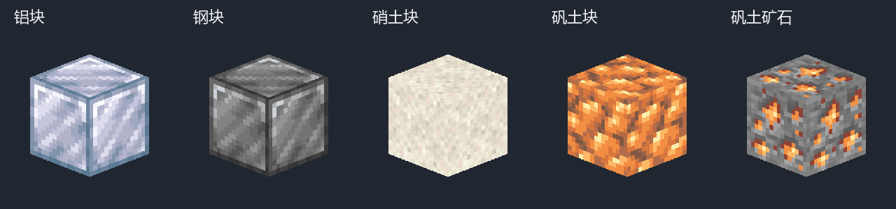
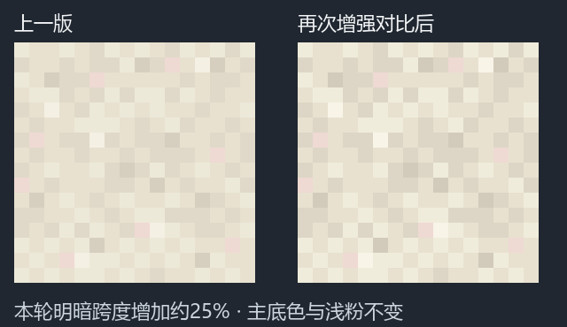
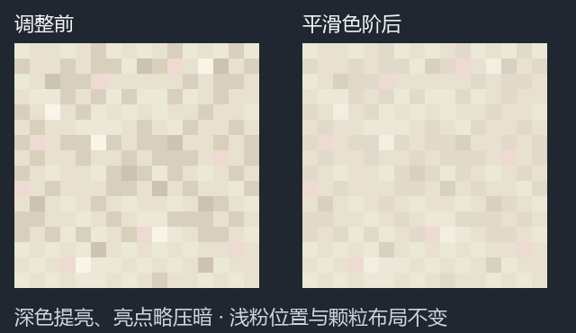
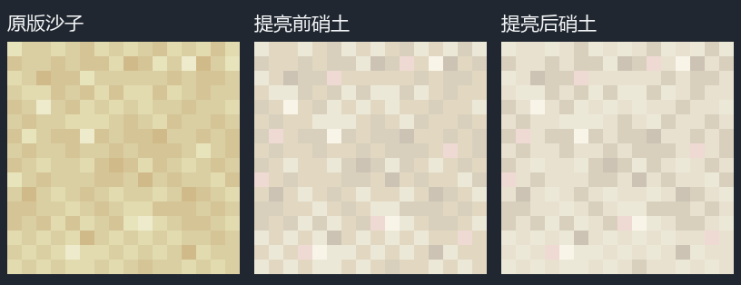
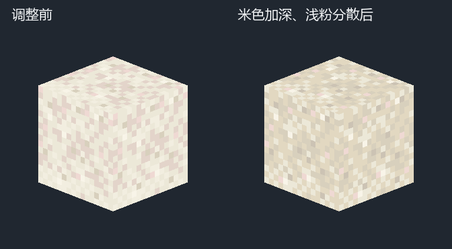
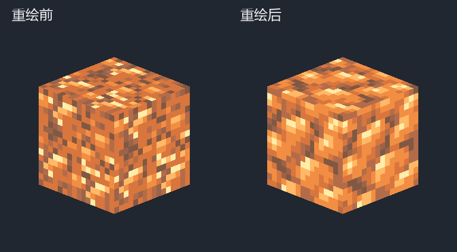
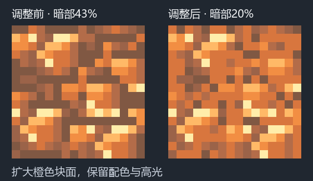
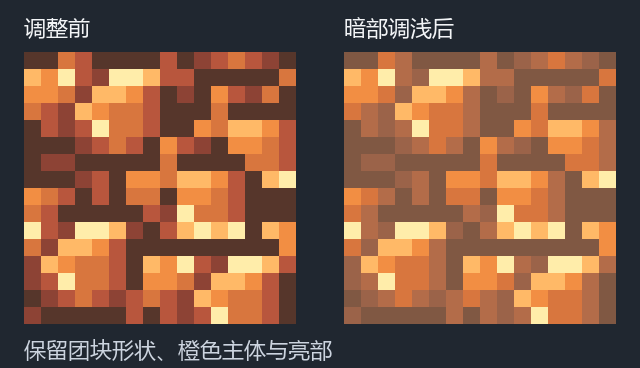
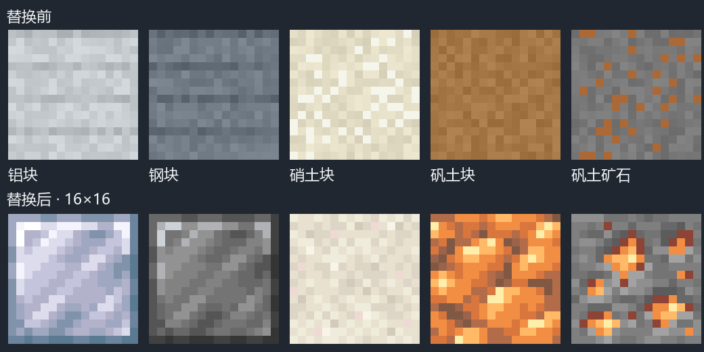
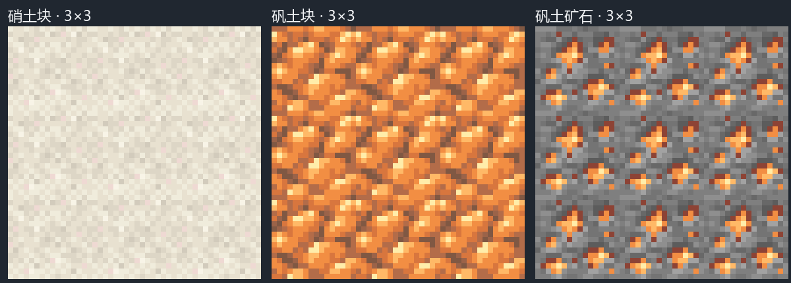

# 矿物与储存方块贴图

> 当前计数：方块首版与矾土块连续修订归入0.1.113；硝土块连续修订归入0.1.114。下文原0.1.118–0.1.125及校验报告保留旧标签，见[旧新对照](../../美术连续修订版本合并说明.md)。

2026-10-30，0.1.118–0.1.125：替换铝块、钢块、硝土块、矾土块与矾土矿石5张16×16 RGBA贴图，全部像素不透明，沿用现有六面共用纹理模型。可编辑源文件通过当前打开的Aseprite绘制、保存和导出。燃料桶方块保留原图，后续详细制作。

## 硝土块对比度微调

0.1.125对同一项对比度修复继续调整，本轮将明暗跨度从32.51增至40.51（约25%）；相对平滑版的28.51累计增加约42%。最大相邻亮度差仍小于11，主底色、浅粉与全部颗粒位置不变。[3×3铺贴对比](revisions/saltpeter_contrast_more/tiling-comparison.png)、源文件与检查记录见[当前修订目录](revisions/saltpeter_contrast_more/)，前一轮保留在[初次微调目录](revisions/saltpeter_contrast/)。

## 硝土块米色色阶平滑

0.1.124提亮两档深米色，并略压暗最亮颗粒：`#ccc3b4→#d8d1c2`、`#d8d0bd→#e1daca`、`#f8f4e8→#f2eee1`，共82个像素。中性色阶的最大相邻亮度差由约17缩小到9以内；主底色、8个浅粉点及全部颗粒位置不变。[3×3铺贴对比](revisions/saltpeter_ramp/tiling-comparison.png)、源文件与亮度检查见[修订目录](revisions/saltpeter_ramp/)。

## 硝土块中间色提亮

0.1.123将108个主米色像素由`#e2d8c1`提亮为黄感较弱的`#e8e1d0`，让底色更接近浅米白；其余148个像素不变。沙粒布局及8个浅粉点的位置保持不变。[3×3铺贴对比](revisions/saltpeter_midlight/tiling-comparison.png)、修改前后PNG、源文件及检查记录见[修订目录](revisions/saltpeter_midlight/)。

## 硝土块米色与浅粉颗粒调整

0.1.122将硝土块主色改为稍深的米色，采用`#ccc3b4／#d8d0bd／#e2d8c1`三档米色，共185个像素；浅亮区由171个降至63个，约占25%。浅粉保持8点，将上沿两点交换到底部空缺处，四个象限各2点，不增加粉色面积。原版沙子的252个颗粒类别位置保持不变，只有2组位置交换。

[平面比较](revisions/saltpeter_balance/comparison.png)、[3×3铺贴比较](revisions/saltpeter_balance/tiling-comparison.png)、源文件、像素规格与检查记录见[修订目录](revisions/saltpeter_balance/)。

## 矾土块团块与接缝重绘

0.1.121重绘断裂的暗缝和难辨的矿料结构。借鉴粗铁块的粗矿团块布局，重新安排矾土的橙色正面、赭棕侧面及浅黄顶面高光，用连贯细缝分出完整矿料。7色调色板保持不变；最深两档为29个像素（约11%），三档阴影共71个（约28%）。细缝在纹理边界继续连接，替代逐点填补阴影的布局。

可编辑源文件、修改前后PNG、[3×3铺贴对比](revisions/bauxite_redraw/tiling-comparison.png)、参考图及像素检查保存在[重绘目录](revisions/bauxite_redraw/)。

## 矾土块暗部占比调整

0.1.120收窄深色缝隙并扩大橙色矿料块面，70个阴影像素改为现有中间色，最深两档由109个像素（约43%）降至51个（约20%）。三档阴影合计由155个降至85个；7色调色板、原有101个主体与亮部像素保持不变。修改前后PNG、源文件、[3×3铺贴对比](revisions/bauxite_shadow_area/tiling-comparison.png)及检查记录保存在[修订目录](revisions/bauxite_shadow_area/)。

## 矾土块暗部调整

0.1.119将三档暗部由`#56362b／#8d4335／#b8563d`调浅为`#805843／#9b6349／#b36c49`，共155个像素；其余101个主体及亮部像素、团块轮廓和高光位置不变。修改前后PNG、源文件、像素规格与一致性检查保存在[修订目录](revisions/bauxite_shadow/)。

## 纹理与配色

| 方块 | 纹理规则 | 配色 |
|---|---|---|
| 铝块 | 原版1.21.1金块的像素布局与9层色阶 | 当前铝锭的冷银蓝8色，加1个相邻色阶中间色 |
| 钢块 | 同一金块布局，保留边框与面内纹理 | 当前钢锭的钢灰8色，加1个相邻色阶中间色 |
| 硝土块 | 原版沙子的6色颗粒布局，交换2组浅粉颗粒位置 | 低对比米白、米色色阶及少量浅粉 |
| 矾土块 | 参照粗铁块的粗矿团块结构，重绘矾土橙赭折面、顶面高光及连续细缝，跨纹理边界衔接 | 延续矾土物品的橙色与高光，三档暗部调浅为赭棕色 |
| 矾土矿石 | 原版金矿石，仅替换4种有色矿点 | 矾土的赭红、橙、浅橙及淡黄高光 |

矾土矿石保留197个灰色石底像素，59个矿点像素按原位置换色。铝块与钢块的9种原版颜色逐一映射，像素类别布局保持一致。硝土块使用物品主体浅色，不将物品外轮廓深色铺满方块。

当前物品配色快照及6张原版参考保存在[参考目录](references/)。原版参考从本机Minecraft 1.21.1客户端资源提取；矾土物品的舰R造型来源及铝、钢配色依据延续[材料物品贴图记录](../materials-20261030/README.md)。原版和游戏参考用于本项目美术制作，不作为独立原创素材发布。

## 源文件与预览

- [Aseprite源文件](sources/)：5张方块图；[像素规格](pixel-specs.json)记录逐像素颜色。
- [替换前PNG](previous/)与[替换前后对比](before-after.png)。
- [3×3连续铺贴](tiling-3x3.png)：硝土、矾土块及矾土矿石。
- [Blockbench预览工程](mineral-blocks-preview.bbmodel)：独立立方体和5张内嵌纹理；原有工程保留。此工程只用于检视，未改生产模型。
- [映射与保护清单](mapping.json)、[Aseprite检查](aseprite-validation.json)与[工程检查记录](verification.json)。

## 检查范围

检查16×16尺寸、全不透明像素、颜色映射、金块与沙子的纹理布局、矿石灰色石底保留，以及5张目标外的117张PNG不变；燃料桶与既有9张材料物品图均在保护范围内。静态资源检查和JAR资源打包结果见工程检查记录。已查看Aseprite放大预览、连续铺贴和Blockbench六面UV效果；视觉效果及实际游戏光照仍需人工确认。
