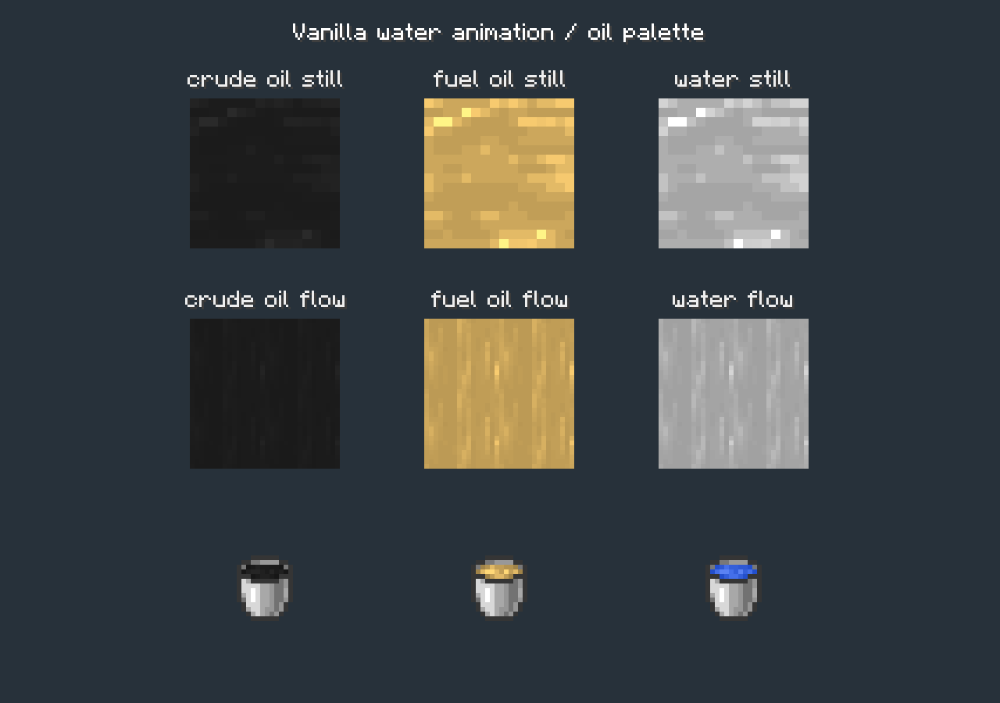

# 原油、燃油与桶图外观

> 当前阶段计数为0.1.116–0.1.119。下文原0.1.127–0.1.130及报告保留生成时的原始标签，见[旧新对照](../../美术连续修订版本合并说明.md)。

2026-10-31，0.1.127–0.1.130：完成柴油配色、原版水纹理动画、两种原版桶样式三项美术调整，并修正原油透色过多、观感偏浅的问题。六张生产PNG及六份可编辑源文件由已打开的Aseprite制作并导出。



上、下两排分别为静水与流水纹理，左为原油、中为燃油、右为原版水的灰度纹理参照；底排为对应桶物品。两张截图使用游戏客户端实际烘焙图集，不代表世界内光照或光影验收。

## 原版水如何流动

本机Minecraft 1.21.1源码中的`LiquidBlockRenderer`读取`FluidState.getFlow`：水平方向速度为零时使用静水纹理，有流向时使用流水纹理，并通过`atan2`旋转顶面UV；侧面使用流水纹理。因此方向效果由通用流体渲染器实现，不需要为油增加移动贴图坐标的代码。

纹理自身的运动由另一层负责：PNG纵向条带包含32帧，旁边的`.png.mcmeta`定义动画。`SpriteContents`读取元数据，`TextureAtlas`中的ticker逐帧上传当前画面；默认关闭插值。

| 纹理 | 条带尺寸 | 单帧尺寸 | 帧数 | 帧时长 | 完整循环 |
|---|---|---|---|---|---|
| 静水 | 16×512 | 16×16 | 32 | 2 tick | 64 tick，约3.2秒 |
| 流水 | 32×1024 | 32×32 | 32 | 1 tick | 32 tick，约1.6秒 |

原版流水32帧中有重复，实际包含16个不同画面。原油与燃油保留原始像素位置、帧序、重复帧与元数据。原油alpha现为242（约95%不透明，约5%透明），燃油保留原版alpha=180（约71%不透明）；原油的RGB色阶不变。Aseprite源文件保留为整张条带，Minecraft按元数据切帧，无需把Aseprite时间轴帧数设为32。

## 颜色与桶图

| 对象 | 主色 | 规则 |
|---|---|---|
| 原油 | `#1B1B1B` | 保留已有深灰色方向，随水纹理灰阶形成明暗 |
| 燃油 | `#C19E57` | 取柴油动力官方1.21.1分支柴油静水纹理的出现次数最多的RGB |
| 原油桶／燃油桶 | 对应油色 | 原版水桶的金属、轮廓与透明区不变，仅改桶口24个液体像素 |

柴油来源为[官方仓库柴油纹理](https://github.com/george8188625/Create-Diesel-Generators/blob/79ce136730871b6f3f7b55d3cc748ff2bec2ad12/src/main/resources/assets/createdieselgenerators/textures/block/diesel_still.png)，固定提交`79ce136730871b6f3f7b55d3cc748ff2bec2ad12`。其主色为193／158／87；配色参考没有引入该模组的代码、物理属性或依赖。参考PNG、注册源码及MIT许可副本已归入外部资料库，本地路径见[参考文件索引](references/README.md)。

水条带的灰度`g`按`min(255, round(主色通道 × g / 165))`转换，165为原版静水最常见灰度。原油alpha统一242，燃油保留原版水纹理alpha=180。桶口以原版水桶中间蓝色的亮度为基准保留五档明暗。完整色表见[pixel-spec.json](pixel-spec.json)。

颜色已写入PNG，四种油状态的客户端tint均为`0xFFFFFFFF`，避免重复乘暗；油色不会随群系水色改变。两种油的物理流动、水面保护和原版倒桶替换水格的行为不变；可放置的燃料桶方块外观仍另行制作。

## 源文件与验证

- [sources](sources/)：四张流体条带和两张桶图的`.aseprite`源文件；原油源文件已同步alpha=242。
- [before](before/)：调整前六张PNG，保留已有美术成果。
- [第二张客户端截图](previews/oil-animation-39.png)：不同动画时刻的实际渲染。
- [verification.json](verification.json)：逐像素、动画元数据、桶身不变、发行包和客户端结果。

验证环境为Windows／JDK21.0.5／Minecraft1.21.1／NeoForge21.1.259。独立主菜单客户端核对四种流体状态、白色tint、32帧和全部源像素，并主动推进同一套图集tick72次；显卡回读观察到静水32个、流水16个不同画面。主菜单没有世界tick，因此检查器显式推进图集，未加载玩家存档。

构建和316个JSON资源静态检查通过；227项GameTest仅编译，本轮未重新执行服务器回归。原有水面与倒桶保护代码未改；0.1.130全部生产class与0.1.129逐字节一致。已补充固定白天的亮色地面、瀑布及水面浮油实景检查，见[世界内截图与记录](world/README.md)；其他光照、第三方光影及主观视觉确认仍保留人工范围。

复现命令在项目目录中执行：

```powershell
$env:JAVA_HOME='C:/Program Files/Java/jdk-21'
python tools/verify_resources.py
./gradlew.bat --offline --console=plain -PbuildOutput=build/oil-appearance-20261031/artifacts build
./gradlew.bat --offline --no-configuration-cache --console=plain --init-script docs/art/oil-appearance-20261031/client-init.gradle -PbuildOutput=build/oil-appearance-20261031/artifacts runAcceptanceClient
```

隔离配置已保存为[client-init.gradle](client-init.gradle)，本机执行日志位于`build/oil-appearance-20261031/`。该脚本将acceptanceClient的运行目录设为同目录的`run-client`，开启`piranport.acceptance.oilAppearance=true`，并把`piranport.acceptance.oilOutput`设为`client`目录；检查器仅在显式开启时运行，截图沿用`UiTooltipCapture`。

原油透明度修订的旧PNG、旧源文件和[检查记录](revisions/crude-opacity/verification.json)保留在[修订目录](revisions/crude-opacity/)。

原油透明度最终约5%（alpha=242）；本轮继续微调仍计入0.1.130同一显示修正。上一档和[当前验证](revisions/crude-opacity-5/verification.json)保存于[修订目录](revisions/crude-opacity-5/)。

## 世界内实景

独立新世界的[整体场景、静态池、瀑布动画和浮油近景](world/README.md)已归档。原油维持约5%透明度，两处浮油下方126个水方块保持完整；本轮未改动生产文件，版本保持0.1.130。
