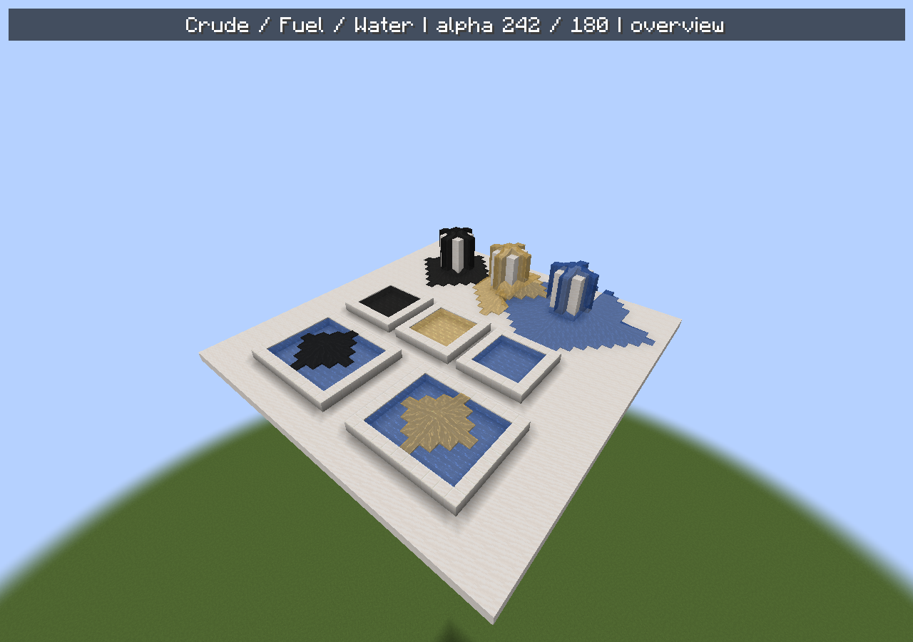

# 油品世界内渲染检查

2026-10-31 17:32，0.1.130。使用独立新建超平坦世界，在固定白天光照下查看原油、燃油与原版水；未改动任何生产代码或贴图。



上排为瀑布状流动，中排为静态池，下排为水面浮油。原油为深黑，燃油为柴油黄，原版水为蓝色。白色石英地面用于观察背景透色。

- [静态池近景](oil-world-pools.png)：原油维持约5%透明度，亮色池底没有把油色明显冲淡；保留原版水的表面纹理。
- [流水画面A](oil-world-waterfalls-a.png)与[画面B](oil-world-waterfalls-b.png)：同一视点的不同动画时刻，沿下落面及水平地面显示流动纹理。
- [水面浮油](oil-world-floating.png)：油层停留在水格上方并横向铺开，两处水池下方共126格水保持完整。

原版客户端中未发现紫黑缺图或异常白化。原油alpha仍为242，燃油仍为180。原版流水的阶梯边缘及水面上方一格的油层厚度保持既有规则。

检查环境为Windows／JDK21.0.5／Minecraft1.21.1／NeoForge21.1.259，未安装光影包。该场景不代表其他群系、昼夜条件或第三方渲染模组的兼容性确认；主观美术确认仍独立保留。

场景和截图由测试源集`OilWorldAppearanceChecks`创建，截图沿用`UiTooltipCapture`的实际渲染阶段入口。夹具只在`piranport.acceptance.oilWorld=true`时启用，未进入发行JAR。证据见[verification.json](verification.json)。

本机运行目录为`build/oil-world-20261031/run-client`，测试自动创建`oil-visual-1793439100467`并正常保存退出，没有读取玩家存档。

```powershell
$env:JAVA_HOME='C:/Program Files/Java/jdk-21'
./gradlew.bat --offline --no-configuration-cache --console=plain --init-script docs/art/oil-appearance-20261031/world/client-init.gradle build runAcceptanceClient
```

复跑会新建独立测试世界；完整运行输出位于`build/oil-world-20261031/client.log`。本轮只编译既有227项GameTest，没有重复运行服务器回归；全部生产文件与运行前哈希一致。
