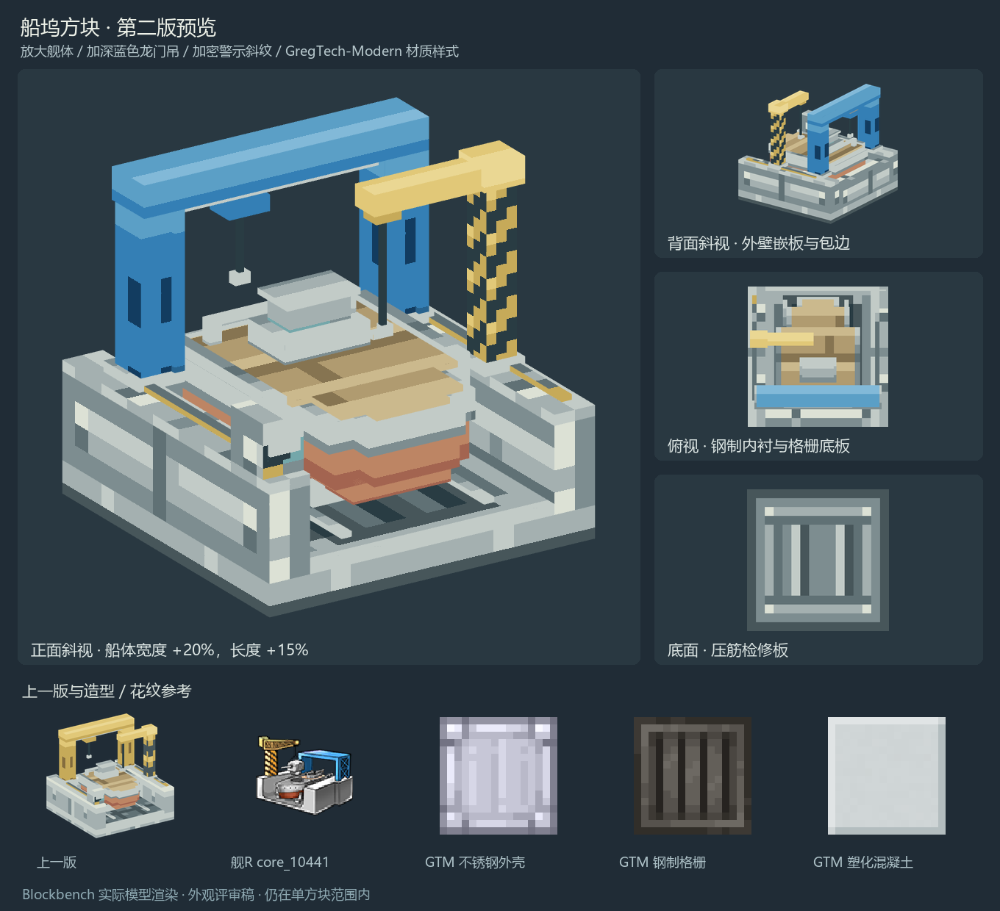

# 船坞方块模型预览稿

2026-10-31，第二版。保留舰R五种改造核心中的单方块船坞结构，放大灰色舰体与红色船底；双柱龙门吊在`core_10441`配色基础上加深蓝色，单柱悬臂吊保留黄色并加密黄黑斜纹。坞体花纹统一参考GregTech-Modern。

本稿用于外观评审。工程中的船坞模型、贴图、碰撞、交互和制造代码保持现状，当前版本仍为0.1.124；本稿未计入新的功能或版本交付。

| 项目 | 规格 |
|---|---|
| 范围 | 16×15.5×16模型单位，完整包含在单个方块内 |
| 几何 | 56个轴对齐长方体，6个职责分组 |
| 结构 | 坞池、承台与轨道、待建舰体、门式吊架、悬臂吊、控制箱 |
| 材质 | 128×64像素图集，按部位布置16×16材质区，28色调色板 |
| 像素密度 | 主体每模型单位1纹理像素；单柱警示斜纹局部加密到每单位2像素；图集扩展不放大原有材质 |
| 源文件 | 原生Blockbench通用模型与Aseprite图集 |

## 文件

- [Blockbench模型](sources/shipyard_draft.bbmodel)，嵌入完整纹理，可独立打开编辑。
- [Aseprite图集源文件](sources/shipyard_atlas.aseprite)与[PNG图集](textures/shipyard_atlas.png)。
- [Java方块模型草稿](models/shipyard_draft.json)，采用1.21.1的常规元素／面UV结构，尚未接入生产资源。
- [正面斜视](previews/front_three_quarter.png)、[背面斜视](previews/rear_three_quarter.png)、[俯视](previews/top.png)、[正视](previews/front.png)、[底视](previews/bottom.png)。
- [像素与几何规格](design-spec.json)、[检查记录](validation.json)、[Aseprite检查](aseprite-validation.json)。

图集由实时Aseprite绘制、导出。模型通过本机Jason Blockbench MCP创建，预览是Blockbench对实际模型的正交渲染；评审图只做背景、缩放和排版。

## 当前造型

船体相对首版宽度增加20%、长度增加15%、高度增加12%，仍位于坞池与吊架之间。保留两侧、后方间隙，收紧龙门吊底座的内缘，舰体不与两套吊装结构相交。

蓝色吊架独立使用蓝色横梁、端盖、柱面和起吊小车材质。蓝色五级色阶整体加深，主体色由`#55bbff`调整为`#347fb5`，保留高光与暗面区分；黄色悬臂吊维持原色。黄黑斜纹保持斜向，使用独立的双倍像素密度，增加柱身的条纹数量。

外壁改为包边嵌板，边缘增加分段接缝与紧固点；内壁改为分层钢制内衬，深灰底板改为纵向格栅，底面采用带压筋的检修板。狭长部位按实际可见尺寸重绘，避免把完整方形外壳直接压扁。

首版源文件、素材和预览保留于[第一版归档](revisions/draft-01/README.md)。

## 原图参考

五张原图来自本机舰R v5.5.1拆包的`assets/data/ui/icon.unity3d`：`core_10141`、`core_10241`、`core_10341`、`core_10441`、`core_10541`，均为126×126。

参考原图统一保存在`E:/Leisure/Coding/Minecraft/mc-refs/WarshipGirlsR/v5.5.1/remodel-cores`；[来源索引](references/sources.json)记录原包路径、Texture2D标识和SHA-256。造型提取五图共有结构，舰体使用中性的施工状态，不绑定具体舰种或制造配方。

花纹样式参考[GregTechCEu/GregTech-Modern](https://github.com/GregTechCEu/GregTech-Modern)，使用既有固定提交`ec40d99d6a6e24d130bf4ddae0d7243281afad45`的不锈钢／钢制外壳、格栅和塑化混凝土等六张贴图，提取压边、嵌板、长槽及紧固点结构，并按坞体比例重新绘制。原图位于统一参考库的`GregTech-Modern/reference-snapshots/`下，详见[来源索引](references/gregtech-modern.json)及[参考拼图](previews/gregtech-modern-reference.png)。

## 检查范围

已核对56个元素、6个分组、单方块边界、舰体与吊装结构无相交、各面的UV、嵌入纹理与Aseprite导出一致，以及五个视角均无画面裁切。Aseprite图集检查通过。此阶段为静态外观预览，未启动游戏或执行游戏内验收。
