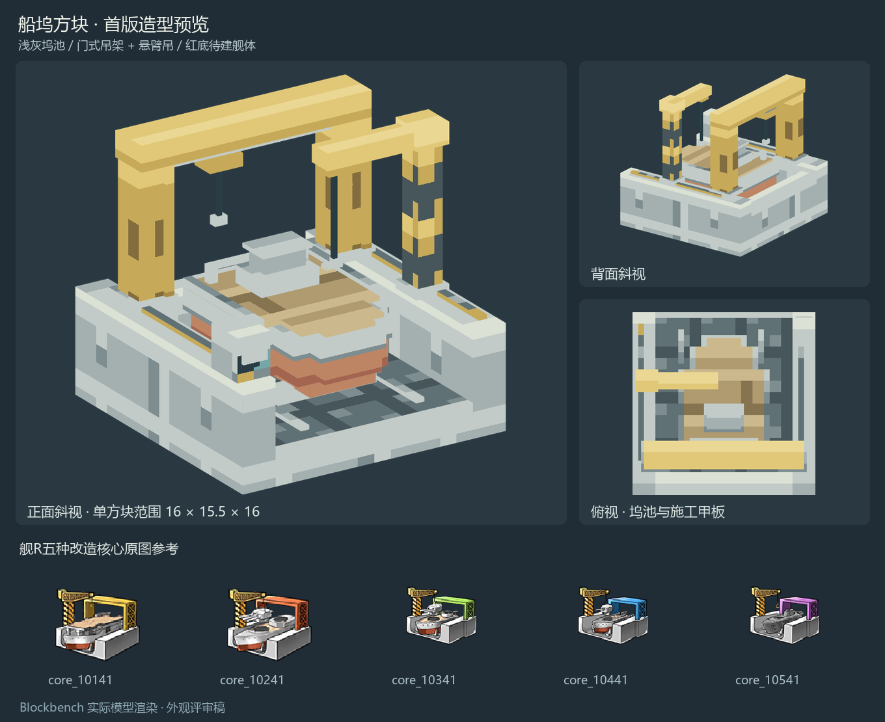

# 船坞方块模型预览稿

2026-10-31。参考舰R五种改造核心原图中的共同船坞结构，制作单方块造型：浅灰敞口坞池、后部门式吊架、侧面悬臂吊，以及灰色舰体、红色船底和木色施工甲板。主色采用低饱和吊机黄、灰白混凝土和铁灰。

本稿用于外观评审。工程中的船坞模型、贴图、碰撞、交互和制造代码保持现状，当前版本仍为0.1.124；本稿未计入新的功能或版本交付。

| 项目 | 规格 |
|---|---|
| 范围 | 16×15.5×16模型单位，完整包含在单个方块内 |
| 几何 | 56个轴对齐长方体，6个职责分组 |
| 结构 | 坞池、承台与轨道、待建舰体、门式吊架、悬臂吊、控制箱 |
| 材质 | 64×64像素图集，16块16×16材质区，23色调色板 |
| 像素密度 | 每模型单位1纹理像素，即每方块16像素；64×64是图集大小 |
| 源文件 | 原生Blockbench通用模型与Aseprite图集 |

## 文件

- [Blockbench模型](sources/shipyard_draft.bbmodel)，嵌入完整纹理，可独立打开编辑。
- [Aseprite图集源文件](sources/shipyard_atlas.aseprite)与[PNG图集](textures/shipyard_atlas.png)。
- [Java方块模型草稿](models/shipyard_draft.json)，采用1.21.1的常规元素／面UV结构，尚未接入生产资源。
- [正面斜视](previews/front_three_quarter.png)、[背面斜视](previews/rear_three_quarter.png)、[俯视](previews/top.png)、[正视](previews/front.png)。
- [像素与几何规格](design-spec.json)、[检查记录](validation.json)、[Aseprite检查](aseprite-validation.json)。

图集由实时Aseprite绘制、导出。模型通过本机Jason Blockbench MCP创建，预览是Blockbench对实际模型的正交渲染；评审图只做背景、缩放和排版。

## 原图参考

五张原图来自本机舰R v5.5.1拆包的`assets/data/ui/icon.unity3d`：`core_10141`、`core_10241`、`core_10341`、`core_10441`、`core_10541`，均为126×126。

参考原图统一保存在`E:/Leisure/Coding/Minecraft/mc-refs/WarshipGirlsR/v5.5.1/remodel-cores`；[来源索引](references/sources.json)记录原包路径、Texture2D标识和SHA-256。造型提取五图共有结构，舰体使用中性的施工状态，不绑定具体舰种或制造配方。

## 检查范围

已核对56个元素、6个分组、单方块边界、各面的UV、嵌入纹理与Aseprite导出一致，以及四个视角均无画面裁切。Aseprite图集检查通过。此阶段为静态外观预览，未启动游戏或执行游戏内验收。
