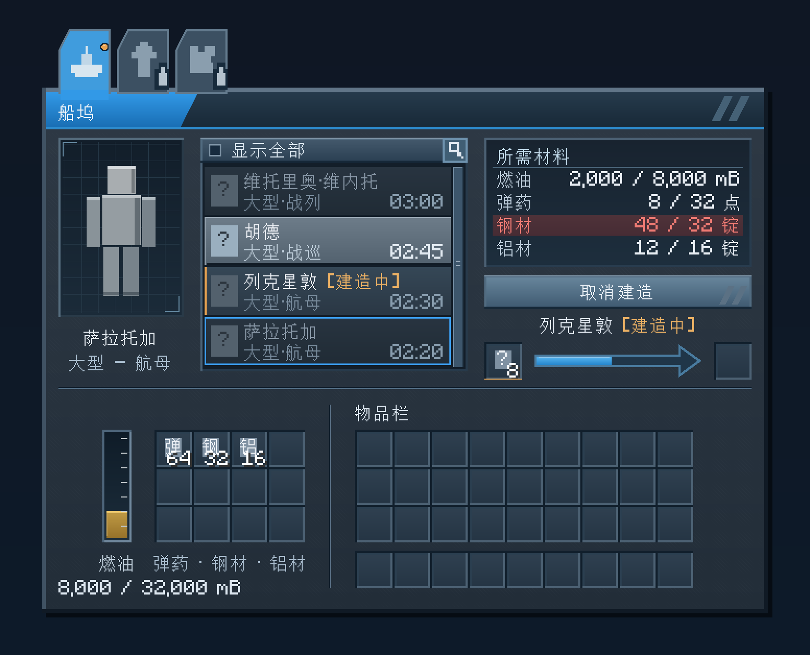

# 船坞 GUI 定稿与功能设计说明

> 2026-10-24。当前外观、功能布局及各状态预览已归档于本目录；本文区分已确认的功能规则和待讨论建议。船坞已接入游戏，功能、参数及验证以[实现方案](../3.2.2-船坞-实现方案.md)为准；本目录设计预览中的旧消耗与时间仍为排布示意，图标及舰娘模型仍允许占位。

当前游戏内的分类说明已统一为“船型·舰种·国籍”，列表、模型及悬浮一致；[实际截图](分类说明/README.md)优先于旧设计图中的说明文字。

## 1. 外观定稿

- [定稿 PNG](船坞-GUI-定稿.png)
- [可编辑 SVG（含悬浮提示）](船坞-GUI-定稿.svg)
- [后续 GUI 风格规范](GUI-风格规范.md)

以下是同一套最终布局的功能状态，不是布局中间版本：

| 状态 | 预览图 | 可编辑稿 |
|---|---|---|
| 产物待取，图纸已空，显示全部 | [PNG](状态预览/船坞-GUI-产物待取.png) | [SVG](状态预览/船坞-GUI-产物待取.svg) |
| 无图纸，筛选条仍常驻 | [PNG](状态预览/船坞-GUI-无图纸.png) | [SVG](状态预览/船坞-GUI-无图纸.svg) |
| 无图纸直接查询舰船 | [PNG](状态预览/船坞-GUI-无图纸查询.png) | [SVG](状态预览/船坞-GUI-无图纸查询.svg) |
| 长舰名在建及省略显示 | [PNG](状态预览/船坞-GUI-长舰名.png) | [SVG](状态预览/船坞-GUI-长舰名.svg) |
| 弹药材料量悬浮 | [PNG](状态预览/船坞-GUI-弹药悬浮.png) | 定稿 SVG 中悬浮材料缓存首格 |

选定完成音效：[common_craft_success.wav](音效/common_craft_success.wav)；参数与拆包来源见[音效来源说明](音效/音效来源.md)。

主界面保持紧凑、左右均衡的排布：左上模型预览，中上舰船列表，右上所需材料与建造操作；图纸槽在进度箭头左侧，产出槽在右侧；下方为燃油、材料缓存与玩家物品栏。材料与玩家物品栏之间保留分隔线及均衡留白。

| 项目 | 当前定稿 |
|---|---|
| GUI 主体逻辑尺寸 | 348 × 252 |
| PNG 画布 | 1552 × 1256，逻辑画布 388 × 314，4 倍展示 |
| 模型窗口 | 60 × 86，含边框 |
| 船型标签 | 建造、强化、改造；图标常驻，名称悬浮显示；后两者锁定 |
| 舰船列表 | 4 行可见，带滚动条；顶部全宽筛选条固定，第二行右侧显示总时长 |
| 材料缓存 | 4 列 × 3 行，共 12 格，共用材料池 |
| 玩家物品栏 | 9 × 3 格，加 9 格快捷栏 |
| 物品槽节距 | 18 × 18 |
| 图纸与产出 | 唯一图纸槽和产出槽，各 1 个，所有船型共用 |

全部文字采用 Minecraft 默认字体，图标与模型采用占位符。低饱和石墨灰蓝底、亮蓝选中态、细暗纹和轻微金属渐变沿用通用规范；选中标签页与标题带融合，装饰斜边采用竖 2、横 1 的统一倾角，约 63.435°。

当前规则更新：0.1.75 只保留一个建造工位；生存拆除保存缓存，创造拆除不掉船坞，缓存和取消返还物品全部散落，燃油清除。初期钢铝、弹药和时长倾向不作为配方校验上限；只要求弹药需求为 4 的倍数。不维护内部旧版本存档迁移。

## 当前搜索与确认交互

列表顶部仍为固定全宽栏，右端增加 12×12 搜索按钮。有筛选时亮蓝并带小漏斗；左键编辑，右键清除全部筛选条件，保留“显示全部”状态。船型与国籍均可多选，文字支持中英文部分匹配且忽略大小写，始终受当前许可／全部范围约束。筛选草稿应用后才生效，最后关闭窗口保存已应用状态。详细规则及九组国籍见[实现方案](../3.2.2-船坞-实现方案.md#21-搜索与多选筛选)。

取消确认框根据实际文字与按钮收紧并逐行居中，燃油溢出时保留红色提示，按钮不随动态说明移动。上方 SVG 是主布局示意，以下为当前版本独立测试世界中的实际截图。

| 当前交互状态 | 实际客户端截图 |
|---|---|
| 搜索、船型和国籍多选 | [搜索筛选](状态预览/船坞-GUI-搜索筛选.png) |
| 搜索图标亮蓝并带漏斗、任务继续运行 | [筛选生效](状态预览/船坞-GUI-筛选生效.png) |
| 右键清除后恢复列表 | [清除筛选](状态预览/船坞-GUI-清除筛选.png) |
| 英文控件与大小写搜索 | [英文筛选](状态预览/船坞-GUI-英文筛选.png) |
| 收紧并居中的取消确认 | [取消确认](状态预览/船坞-GUI-取消确认.png) |
| 红色燃油损失提示、按钮位置固定 | [取消燃油溢出](状态预览/船坞-GUI-取消燃油溢出.png) |

## 2. 已确认的功能规则

### 2.1 图纸、列表和模型

- 默认按图纸筛选；无图纸或图纸无效时，舰船列表和所需材料页为空。“显示全部”查询规则见第 3.2 节。
- 唯一图纸槽接收任意有效舰船图纸，复合图纸的全部船型许可共同生效；装备、空白或无效图纸拒绝。运行时仍只补充完整许可相同且可正常堆叠的图纸。
- 不实现自动补充图纸、图纸调配策略。顶部仍可由外部设备输入、取出图纸，但船坞只校验图纸准入、建造预留数量及补充条件，不自行调配。
- 无图纸时，若主动选中了“显示全部”中的查询舰船，模型跟随查询对象；没有主动查询对象时，产出槽有尚未取走的舰装核心则预览该核心，否则显示玩家当前模型。
- 许可无效的图纸不提供制造权限，允许取出；按图纸筛选时列表、材料页为空并回退玩家模型，“显示全部”仍可独立查询；不设置内部旧图纸迁移规则。
- 放置有效且匹配的图纸、选中具体舰船并满足资源条件后，才允许开工。图纸按舰种提供许可，可列出同一舰种下的多艘具体舰船。
- 每艘舰船独立定义燃油、弹药材料值、钢材、铝材消耗以及建造时间。预览数字不作为正式配方。
- 建造期间允许切换舰船选择，继续浏览各舰船。正在建造的舰船在舰名后显示“[建造中]”；常驻任务行位于建造按钮与箭头之间，相对进度箭头水平居中，详见第 3.1 节。
- 舰船浏览不改变已开工任务的目标、费用或耗时。
- 配方查询直接在船坞内进行。“显示全部”作为固定的全宽勾选条常驻舰船列表顶部，宽度包含列表滚动条；不参与条目滚动，无图纸时仍显示并允许勾选、直接查询预览。
- 长舰名超出当前区域可用宽度时截断并显示省略号“…”；保留完整状态后缀，悬浮显示完整舰名。不缩放默认字体，不让文字推开相邻栏位。
- 舰娘模型先用占位符，正式模型与后续舰船参数一并补充。

### 2.2 开工、进度与完工

- 只保留一个建造工位，一次建造一艘，配备 12 格材料缓存和 32000 mB 燃油罐。图标标签为建造、强化、改造；仅建造开放，后两者灰化带锁且不可点击，不预留隐藏库存。
- 燃油和材料在开工时投入；运行工位的图纸槽预留 1 张供本单完工扣除，最后这张不能取走。其余图纸允许取出，也允许补充同一许可列表、且物品数据满足正常堆叠条件的图纸；其他许可的图纸不能替换或加入。数量可以变化，但运行期间槽内必须始终保留至少 1 张合格图纸。
- 图纸预留只约束唯一图纸槽；材料缓存仍可正常使用。已投入资源的任务不受后来缓存变化影响，补充图纸不排队、不自动续建。
- 一张复合图纸可许可不同船型，每次完成只消耗一张；不存在多工位并行或队列。
- 开工时固定本单投入账目、产物身份和总时长；调整配方只影响新任务。目标舰船定义被移除时暂停旧任务，保留取消返还路径。
- 用箭头展示进度；列表右侧显示总建造时间，箭头悬浮显示已用时间、总时间与剩余时间。
- 到达建造时间后，图纸数量减 1，右侧生成一枚对应舰船的舰装核心。完成结算只发生一次。
- 产物遵循已有核心创建规则：熟练度为 0，装备、库存和燃油为空；制造耗油不自动装入核心。
- 不允许自动续建。产物保留在产出槽等待取走；最后一张图纸消耗后，未主动查询其他舰船时，模型按产出槽中的核心回退显示。
- 产出槽只允许取出，不允许外部放入。工位仍有产物待取时，不能开下一单；此时“建造”按钮保持可点击，但点击不实际开工、不扣资源、不预留图纸。建议点击后提示“请先取走本工位产物”。
- 正在进行的建造必须有取消并返还投入资源的路径；是否另设快速完成途径及其代价仍待讨论。
- 标签页以状态点表示工位状态：建造中为橙色点，产物待取为绿色点，空闲不显示点。标签仍只显示功能图标，名称悬浮显示。
- 完成音效选定为舰R拆包中的 `common_craft_success`；已注册游戏声音事件并接入真实完工结算。

#### 2.2.1 建造期间的图纸取放

- 以开工时的完整许可列表为补充依据：许可相同且顺序不同视为相同；只许可当前任务舰种的子集、增加其他舰种的超集都不相同。例如原图许可“战列、战巡”，补充同许可图纸可以；只含“战列”或含“战列、战巡、航母”的图纸均不可以。不得套用合成台的图纸许可合并规则。
- 建议继续遵守原版堆叠条件：同许可但自定义名称或其他组件不同的图纸，不强行合并或覆盖原数据。当前 `BlueprintContent` 已对许可去重、排序，能够直接判定规范化许可列表是否一致。
- 图纸槽显示实际总数，悬浮补充“建造预留 1 张，其余可取”。例如槽内 8 张可取走 7 张；余下 1 张时继续取出无效，补充 16 张后变为 17 张，完工扣 1 张后余 16 张。取消则只解除预留，图纸不扣除。
- 普通左键、右键分半、Shift、双击收集及丢弃均最多取走“当前数量 − 1”，还需受鼠标、背包或目标容器实际接收空间限制；仅剩 1 张时可取数量为 0。拖拽补充也遵守同许可和正常堆叠条件。
- 数字键或副手键触发的整槽交换，建议在建造期间禁用，避免直接取走预留图纸；普通取出多余部分、补充兼容堆叠不受影响。顶部漏斗或管道抽取同样最多取走多余部分，模拟查询不修改数量。
- 所有入口在服务端按操作发生时的实际数量重新判定；多人同时取出、外部设备抽取与完工相遇时顺序结算，不能靠客户端灰化或仅限制鼠标点击保证预留。完工扣除预留的 1 张后解除限制；拆除先取消任务、解除预留，再保存全部剩余图纸。
- 该交互可实现，但原版槽位的“允许拿取”开关只有允许／拒绝两种结果。实现时还需限制实际取出数量，并单独处理会直接替换整槽的快捷操作；GUI 与外部物品能力必须遵循相同规则。相关菜单与能力入口已接入，实际验证范围见实现方案。

### 2.3 取消与返还

- 取消需要额外一步确认；一次误点不能直接终止任务。取消后清空本次进度、解除本次图纸预留，图纸不扣除。
- 确认按钮不与首次取消入口重叠，默认选中“返回”；确认框显示实际任务舰名、返还资源及预计超容销毁的燃油。实际执行仍以当时的缓存、储罐状态结算。
- 确认绑定打开时的工位和具体任务；任务完成、取消或被替换后，旧确认只能刷新界面，不能取消另一单。
- 返还物品先放入材料缓存，放不下的部分进入玩家物品栏，仍放不下的部分作为物品掉落。
- 返还钢铝统一使用本模组对应锭、粒，优先折算为锭，其次为粒，不折算为块；兼容材料不恢复原模组来源与原形态。
- 燃油退回储罐；当前可用容量不足时，只保留能容纳的部分，多余燃油直接销毁。
- 只退回本单净投入的钢铝，不重复返还开工时已经找零的部分。例如用 1 块钢支付 3 锭、已找零 6 锭，取消时返还 3 锭。
- 取消时按实际扣除的弹药种类、数量和原有物品数据返还，保持原物原数；弹药不折算成钢铝或其他替代物品。
- 找零或返还溢出时，玩家物品栏的接收者为当前操作者：开工找零归开工者，取消返还归确认取消者，拆除返还归拆除者；不存在操作玩家时，在船坞位置掉落。任务不绑定最初开工的玩家。

### 2.4 材料扣除和找零

- 钢铝允许块、锭、粒混合投入；按 1 块 = 9 锭 = 81 粒精确折算。
- 钢、铝兼容其他模组对应材料，按物品通用标签识别：`c:storage_blocks/steel`、`c:ingots/steel`、`c:nuggets/steel`，以及对应的 `aluminum` 三项；不按显示名称或只按本模组物品 ID 判断。
- 钢铝找零与退款统一输出本模组对应锭、粒，保持材料量守恒；弹药继续原物原数返还，二者分别处理。
- 优先消耗粒和锭等零碎材料，必要时使用块并找零。
- 找零先进入材料缓存，再进入玩家物品栏，剩余部分掉落；不因找零空间不足阻止开工。
- 材料输入允许本模组的主炮弹药、鱼雷、深水炸弹、导弹四种弹药。点数与钢、铝分别计量；深水炸弹 1 点／件、主炮弹药和鱼雷均为 2 点／件、导弹 4 点／件，制造配方后续讨论。
- 弹药按缓存栏位顺序优先消耗，以左到右、上到下作为当前布局的栏位顺序。对当前栏位计算所需数量时，不足 1 个向上取整；满足需求后停止消耗后续栏位。
- 弹药按整件取整扣除，完工不产生弹药找零；取消时退回实际扣除的完整弹药。例：需求 4 点，先消耗 1 件深弹，剩余 3 点由鱼雷补足时需 2 件，实际共投入 5 点；取消退回这 1 件深弹和 2 件鱼雷。
- 材料页悬浮列出本次预估的实际扣除：弹药种类、件数、需求点数和实际投入点数；已开工的实际投入另由任务信息展示，不被当前浏览舰船的配方覆盖。
- 四种弹药悬浮显示单件材料量及当前堆叠合计，使用上述 1／2／2／4 点。预览数字仅供布局展示，实际参数以实现方案和工作簿为准。

### 2.5 燃油储罐和外部交互

- 储罐容量为 32000 mB，对应两只燃料桶的默认容量；这里是船坞的固定设计值，不依赖燃料桶容量配置的当前值。
- 只接收本模组燃油。允许桶、本模组燃料桶交互，也允许其他模组流体管道交互。
- 流体管道可连接四个侧面和底面，允许灌入和抽出，顶部不允许连接燃油能力。
- 在 GUI 的燃油储罐区域，使用鼠标携带的本模组燃料桶或其他模组兼容储罐交互：左键向船坞加油，右键从船坞取油；该左右键规则不接管世界中的左键挖掘。
- 每次尝试双方能力允许的最大可转移量，不设置小批量上限。可部分转移的储罐尽量转移；普通桶仍受整桶交互限制，不能因空间不足丢失半桶内容。
- 手持燃油容器直接右键船坞方块时，按本次点击开始时的船坞容量状态决定方向：未满则优先将容器燃油灌入船坞；已经满时，若容器有空间接收兼容燃油，则从船坞取油。一次点击只执行一个方向，不在刚加满后立即反向回抽。
- 因此，船坞未满且手持容器无可注入燃油时，不会通过上述世界右键规则自动取油；仍可打开 GUI，使用储罐区右键明确取油。船坞与容器都满时不发生转移。
- 普通加油仅转移双方可容纳的量，未能容纳的燃油留在原容器；取消任务的超容销毁规则不扩展为普通加油损耗。
- 世界中右键容器转移成功时，不同时打开 GUI；无法转移时打开 GUI，便于在储罐区明确选择方向。空手或普通物品右键直接打开 GUI。

| 面 | 物品交互 | 流体交互 |
|---|---|---|
| 顶部 | 唯一图纸槽输入、输出；遵守预留和同许可补充条件 | 不允许 |
| 四个侧面 | 材料输入、输出；优先抽取唯一产物槽，再抽材料 | 允许燃油灌入、抽出 |
| 底部 | 只输出唯一产物槽 | 允许燃油灌入、抽出 |

### 2.6 关闭界面、离线和卸载

- 关闭 GUI 不影响建造，各项缓存保留。
- 计时参考原版熔炉：方块实体正常运行时推进；玩家是否在线本身不决定任务暂停，区块停止运行、卸载或服务器停机期间不按现实时间补算。再次运行后继续保存的进度。
- 这里沿用熔炉的运行与存储时机，不新增持续燃烧消耗或缺燃料进度倒退规则。
- 浏览状态不与玩家身份绑定，船坞保留最后一个关闭 GUI 时的浏览状态。各已打开窗口可独立浏览，关闭时写回机器的最近状态，最后关闭者覆盖前者；不让一次切页强制其他正在浏览的窗口跳页。
- 保存浏览舰船、滚动位置和“显示全部”开关；不保存玩家 UUID。重新打开后失效选择清空，滚动位置限制在有效范围内，不自动跳到首艘或在建舰。

### 2.7 拆除和多人交互

- 拆除时先取消唯一工位进行中的建造、清空进度、返还各单开工投入的材料和燃油并解除图纸预留，再保存剩余缓存；燃油超容时沿用手动取消的溢出销毁规则。
- 拆除不会把正在建造的任务带到新位置继续计时。图纸与尚未取走的产物属于应保留的缓存。
- 已随船坞物品保存的缓存不再额外掉落一份；物品溢出按第 2.3 节交给拆除者，无操作者时在原位置掉落。
- 允许不同玩家分别打开 GUI、切换浏览目标并同时点击操作。所有人访问同一座船坞的唯一工位；同一任务不能重复开工，浏览选择互不覆盖。
- 开工、取消、完工应分别作为不可重复的单次结算。取消确认须对应打开确认框时的那项任务；任务已经结束或替换时，只刷新界面，不取消另一项任务。

### 2.8 Shift 快捷转移

- 图纸只尝试唯一图纸槽；空闲时遵守图纸准入和正常堆叠条件，建造中只补充同一许可列表且数据兼容的图纸。不符合条件时原堆叠不动；从运行图纸槽 Shift 取出时保留预留的 1 张。
- 材料优先进入共享缓存，产物进入玩家物品栏。
- 普通无关物品只在玩家主物品栏与快捷栏间移动，不送入船坞槽位。

## 3. 布局细化与后续选择

任务对齐、文本截断与筛选入口规则已确认；其余建议继续按下文标识。当前主图、各状态图、可编辑稿及选定音效均保存在本目录，后续 GUI 优先沿用这一套风格。

### 3.1 任务舰名与紧凑排布

- 在建造按钮和进度箭头之间固定一行实际任务信息，例如“列克星敦 [建造中]”；完工后显示“萨拉托加 [产物待取]”，空闲时留空。整行文字与箭头中心对齐，逻辑中心 X=296；任务文字可用区域为 X=232–360，宽 128，超长时截断加省略号。切换浏览舰船不改变这一行，没有其他工位，强化和改造标签不接受切换。
- 所需材料框底边保持在逻辑 Y=128；按钮改为 Y=132、高 16；任务行 Y=152；图纸、箭头、产出一排下移至 Y=164。三段相邻留白均为 4 像素，操作区仍在原分隔线上方，下半页位置不变。
- 列表中在建舰名同样加“[建造中]”。把舰名放在条目第一行，舰种与总时长放在第二行，避免状态文字和时长争用同一行；仍保留四行舰船及滚动条。
- 长舰名按 Minecraft 默认字体的实际字宽截断并补“…”；模型名宽度限制为 60，列表舰名及状态合计限制为 96，任务行限制为 128。先预留状态后缀宽度，再缩短舰名，悬浮显示全名。模型下方的舰名也不越过自身区域。
- 模型与所需材料跟随当前浏览舰船；预览在建舰时，模型下方舰名也可以带状态，但不重复扩张区域。箭头悬浮和取消确认框展示实际任务、耗时、投入，不被浏览目标覆盖。
- 建造中的按钮显示“取消建造”，第一次点击只打开已约定的确认框；待取产物时恢复可点击的“建造”，点击显示取走产物的提示。
- 预览同时覆盖：建造列克星敦但浏览萨拉托加、产物待取、无图纸且未勾选、无图纸直接查询、长舰名在建五种状态。后两种以维托里奥·维内托展示截断效果，SVG 悬浮保留全名；数据仅为排布示意。

### 3.2 “显示全部”查询入口

- 固定放在舰船列表顶部，采用带勾选框的全宽条；范围为 X=96、Y=66、宽 128、高 12，与含滚动条的整座舰船选择框同宽。条目滚动区域从 Y=80 开始，滚动不影响筛选条的位置、勾选状态或点击区域；仍保留四行舰船。
- 筛选条的可见性与图纸无关，无图纸且列表为空时也保持显示和可用，不能把筛选条随空列表一起隐藏。
- 默认关闭时继续按图纸许可筛选，无图纸则列表为空。开启时显示全部船型的舰船，即使没有图纸也能选中查看模型、所需材料和总时长；按大型、中型、小型及舰种固定排序，条目第二行显示船型、舰种和总时长。
- 未获图纸许可或材料不足的舰船灰化，但仍能点击查询；图纸许可与材料均满足的条目保留浅灰凸起底。蓝色边框单独表示正在浏览哪一艘舰船。
- “显示全部”只改变查询范围，不提供制造权限。开工仍检查当前工位、实际图纸、材料、燃油及产出状态。
- 开启显示全部本身不自动选择首项；未选中查询对象时，所需材料为空，模型继续按玩家／待取核心规则回退。主动选中查询舰船后再显示其模型和配方。

### 3.3 已选完成音效与播放规则

用户已试听并选定舰R v5.5.1 拆包素材 `common_craft_success`，约 1.541 秒、44100 Hz、双声道。已将[选定 WAV](音效/common_craft_success.wav)与[来源和校验信息](音效/音效来源.md)归档，不再将原版或其他候选作为本轮待选项。

其他试听候选保留在本地 `build/shipyard-audio-review/`，不作为当前定稿素材归入文档目录。

唯一任务实际完工时于船坞附近播放一次，打开 GUI 或取走核心不重播。播放范围以船坞为中心约 16 格；精确音量留待游戏内调音。

### 3.4 仍值得确定的边界

- 产物槽被异常数据占用时，已采用保留已完成任务等待空间的处理，能生成核心时再结算图纸；不丢产物、不重复扣图纸。该异常不应冒用正常“有产物待取”的绿色状态。
- 配方调整、失效目标暂停与取消路径已经实现；只读写当前存储格式，内部旧版本不迁移。异常目标仍保留取消退款路径。

### 3.5 已确认的建造成本与时长

以下按 2026-10-24 用户补充重新设计：每舰直接消耗的钢、铝分别不超过 64 锭，弹药不超过 64 件主炮弹药的等价值，建造不超过 5 分钟并优先控制在 3 分钟以内；弹药采用深弹 2、主炮 4、鱼雷 4、导弹 8 点。上述约束及下列逐舰数值均已确认，已写入数据包配方及军工参数表；设计定稿图继续保留布局示意，未以旧图数字覆盖配方。基准环境为正常生存、已有高炉、尚未依赖刷铁塔或大型工业产线。四种弹药已有占位物品及材料点数，制造配方和实际生产效率仍待确定，后续通过配方成本校准整体获取难度。

#### 3.5.1 舰R参考及版本差异

舰R采用油、弹、钢、铝四资源和图纸进行随机建造；投入比例限制候选舰船，并不存在每艘舰船唯一的固定材料价。下面是公开资料中一般规则的资源下限，顺序为油／弹／钢／铝，不是保证产出指定舰船的配方。[来源：舰R百科“舰船获得方式”](https://www.zjsnrwiki.com/wiki/舰船获得方式)

| 参考舰种 | 油 | 弹 | 钢 | 铝 |
|---|---:|---:|---:|---:|
| 普通战列 | 400 | 30 | 600 | 30 |
| 战巡 | 350 | 30 | 500 | 30 |
| 航母 | 300 | 30 | 400 | 300 |
| 轻母 | 250 | 30 | 300 | 300 |
| 一般潜艇 | 30 | 30 | 60 | 30 |

经典建造时间可参考：萨拉托加 3:40:00、胡德 4:30:00、昆西 1:25:00、欧根亲王 1:30:00、萤火虫 0:20:00、逸仙 0:25:00、维内托 5:10:00。前几项见[2017 年建造时间表](https://shouyou.gamersky.com/gl/201707/932117.shtml)，维内托另由[舰R百科单舰页](https://www.zjsnrwiki.com/wiki/维托里奥·维内托)交叉核对。

现行百科已把萨拉托加、胡德、昆西、欧根亲王、萤火虫等列为不可建造；上述历史时间不代表它们当前仍在建造池。列克星敦在本项目明确采用 CV-2，不能拿 CV-16 的四小时作为她的原作时间；U-47 为非建造取得，长春是果敢的改造身份，也没有独立的常规建造时间。本模组按自己的图纸许可为这些身份定义制造配方，缺少原作时间的项目采用舰种及身份特征估算，不伪造原作参数。[当前获得方式及建造表](https://www.zjsnrwiki.com/wiki/舰船获得方式)、[U-47 资料](https://www.zjsnrwiki.com/wiki/U-47)

#### 3.5.2 MC 节奏与资源预算

- 首批等待目标为小型 45–75 秒、中型 60–105 秒、大型 140–180 秒。舰R只提供舰种资源倾向和时间层级参考，不按原作时长除以固定比例定价；三分钟以内更佳、尽量不超过五分钟仅为初期平衡倾向，不作为配方校验上限。
- 钢、铝各约一组，弹药约一组主炮等价值，同样仅为初期倾向。主炮每件 2 点，一组等价于 128 点；本批最高 96 点，即 48 件主炮弹药。超过这些数值的配方仍可加载和建造，弹药需求只须为 4 的倍数。
- 时间指正常 20 TPS 下的工位实际运行时长，区块卸载后不会按现实时间补算。制造前已有找图纸、采矿、炼料及弹药制造过程，避免再叠加数小时等待。
- 当前钢锭配方为 1 铁锭高炉换 1 钢锭，耗时 100 tick；铝为 1 矾土换 1 铝锭，高炉同为 100 tick。钢应按铁资源衡量，不能按复杂工业模组中的昂贵合金钢估价。
- 单座高炉额外炼 64 钢需 5 分 20 秒，炼 48 铝需 4 分钟，不含采集、炼出原始铁锭和提供炉用燃料的成本；多炉可并行。因此缩短船坞等待后，采集和备料仍有实际分量。原油桶高炉炼燃油桶也为 100 tick，过程燃油与玩家后续给核心补油分别计量。
- 保留战列偏钢、航母偏铝的倾向；每舰按独立配方定义。同级舰只作小幅差异，不因人气或稀有度额外翻倍。长春虽仍属小型驱逐，导弹化身份可以增加铝与弹药预算，但不强制投入导弹。
- 下表钢铝仅为船坞直接扣料；制造投入弹药所用的钢、铝、火药等成本另计。产物仍为空核心，建造用油不装入核心。
- 燃油沿用 1000–6000 mB 分档；弹药供给点数和需求同时折半，主炮每件 2 点，实际投入的弹药件数保持不变。

资源依据为[已实现的矿物规则](../3.1-矿物资源-实现方案.md#3-方块配方与掉落)和当前 `steel_ingot_blasting`、`bauxite_blasting`、`crude_oil_bucket_blasting` 配方；弹药单件点数按本轮用户建议采用，四种弹药的制造配方后续讨论。

#### 3.5.3 首批十舰参数

| 舰船 | 舰种 | 燃油（mB） | 弹药点 | 折合主炮弹药（件） | 钢锭 | 铝锭 | 建造时间 |
|---|---|---:|---:|---:|---:|---:|---|
| 列克星敦(CV-2) | 航母 | 5000 | 48 | 24 | 40 | 48 | 02:30 |
| 萨拉托加 | 航母 | 5000 | 48 | 24 | 44 | 44 | 02:20 |
| 维托里奥·维内托 | 战列 | 6000 | 96 | 48 | 64 | 16 | 03:00 |
| 胡德 | 战巡 | 5000 | 80 | 40 | 48 | 12 | 02:45 |
| 昆西 | 重巡 | 2500 | 40 | 20 | 24 | 8 | 01:30 |
| 欧根亲王 | 重巡 | 3000 | 48 | 24 | 28 | 12 | 01:45 |
| 逸仙 | 轻巡 | 1500 | 24 | 12 | 16 | 6 | 01:00 |
| 萤火虫 | 驱逐 | 1000 | 16 | 8 | 8 | 4 | 00:45 |
| 长春 | 驱逐 | 2000 | 48 | 24 | 20 | 16 | 01:15 |
| U-47 | 潜艇 | 1000 | 24 | 12 | 12 | 6 | 01:00 |

表中时间为分:秒，均为本模组重新分档的建议。维内托以钢和弹药为主要投入，双航母以铝为主要投入；同级身份采用小幅交叉差异。长春的铝与弹药高于普通驱逐，时间仍在小型舰范围内。弹药点是单独的材料预算；“折合主炮弹药”只是全用主炮时的数量，不是还要额外扣一份弹药。

尚无首批身份的两个舰种可先保留以下基准，后续具体舰船再调整，不新增虚构舰船条目：

| 舰种基准 | 燃油（mB） | 弹药点 | 折合主炮弹药（件） | 钢锭 | 铝锭 | 时间（分:秒） |
|---|---:|---:|---:|---:|---:|---|
| 轻母 | 3000 | 32 | 16 | 24 | 24 | 02:00 |
| 重炮 | 1500 | 32 | 16 | 24 | 4 | 01:15 |

容量示例：单次建造维内托需要 6000 mB 燃油、96 弹药点、64 钢锭和 16 铝锭。全用主炮弹药为 48 件，深弹为 96 件；12 格缓存足够。当前四种弹药均按 64 堆叠注册。

#### 3.5.4 弹药折算与后续配方

采用深水炸弹 1 点、主炮弹药 2 点、鱼雷 2 点、导弹 4 点。它们是本模组船坞使用的通用材料量，不是舰R资源点的直接换算，也不代表战斗伤害比例。对应关系为 2 件深弹 = 1 件主炮 = 1 件鱼雷，2 件主炮 = 1 件导弹。

例如维内托 96 点可由 96 件深弹、48 件主炮、48 件鱼雷或 24 件导弹满足，也可以混合投入。初期倾向按主炮等价值评估，属于平衡参考，不限制配方有效性。配方弹药需求取 4 的倍数，使单独使用任意一种弹药都能整除；混合投入仍按缓存先后顺序消耗，最后一件不足时向上取整，不自动寻找最省方案。例：40 点需求先吃掉 1 件深弹后余 39 点，后续只用导弹则还需 10 件，总投入 41 点。

本轮不设计弹药合成。后续优先通过各配方的批量产出和材料成本校准每点获取难度，使一种高点数弹药不会成为成本远低于其他选项的替代物；基础计算继续采用已确定的 1／2／2／4 点。制造弹药间接使用的钢铝与表内船坞直接消耗分别统计，后续配方讨论时再评估合计负担。

### 3.6 后续讨论范围

- 本轮平衡倾向、等待目标、弹药点数及逐舰参数均已确认并实现；轻母、重炮保留基准，暂无具体舰船配方。后续按生存节奏校准，不把旧预览数字直接当作配置。
- 图纸预留 1 张、允许取走余量及补充同许可图纸按用户要求记录；不同自定义数据不强行合并、建造期间禁用整槽交换及悬浮文案均已采用。
- 模型继续用占位符，后续与舰船资料一并加入。
- 快速建造及其代价后续讨论，本轮不增加入口或资源要求。
- 红石／比较器完成状态、外部配方查看器衔接可作为后续扩展；船坞自身先满足直接查询配方的需求。
- 扩展继续遵守不自动续建，不把持续红石信号或排队变成隐式自动开工。

## 4. 现有系统衔接

- [图纸实现方案](../3.2.1-蓝图-实现方案.md)：有效许可查询、每件产物消耗一张完整图纸；船坞的扣除时点以本文已确认规则为准。
- [舰装核心实现方案](../2.1.1-舰装核心-实现方案.md)：按舰船身份创建核心，初始熟练度和内容遵循现有规则。

本目录只保留当前定稿、同一布局的状态预览、选定音效、对应说明及后续 GUI 风格规范，不保留布局中间版本。功能实现与自动、人工验收范围见[船坞实现方案](../3.2.2-船坞-实现方案.md)。
